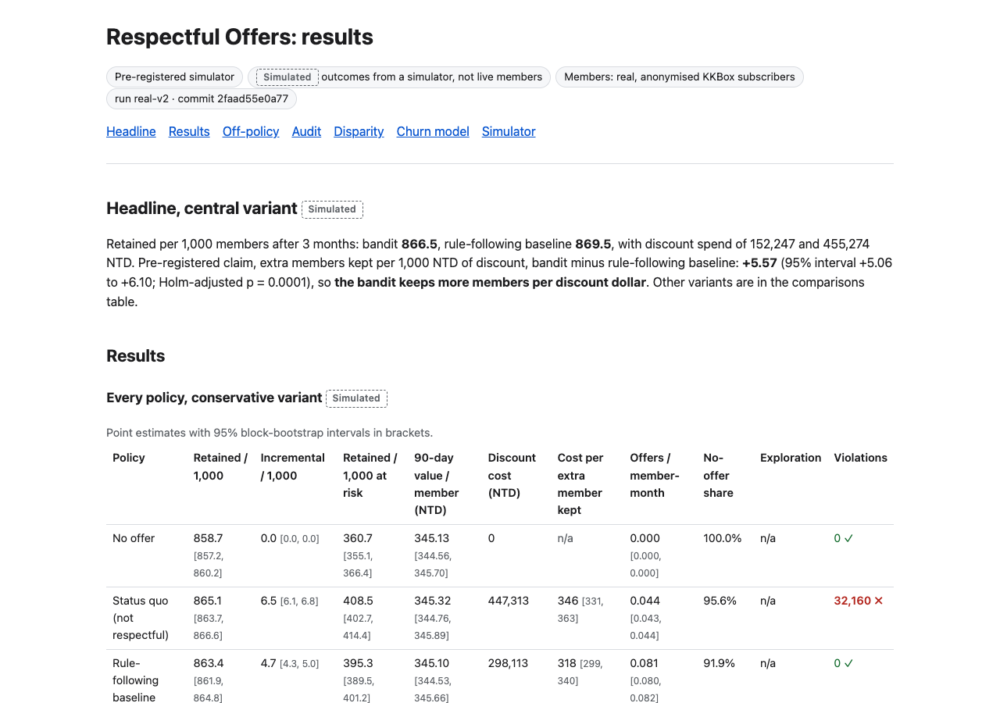
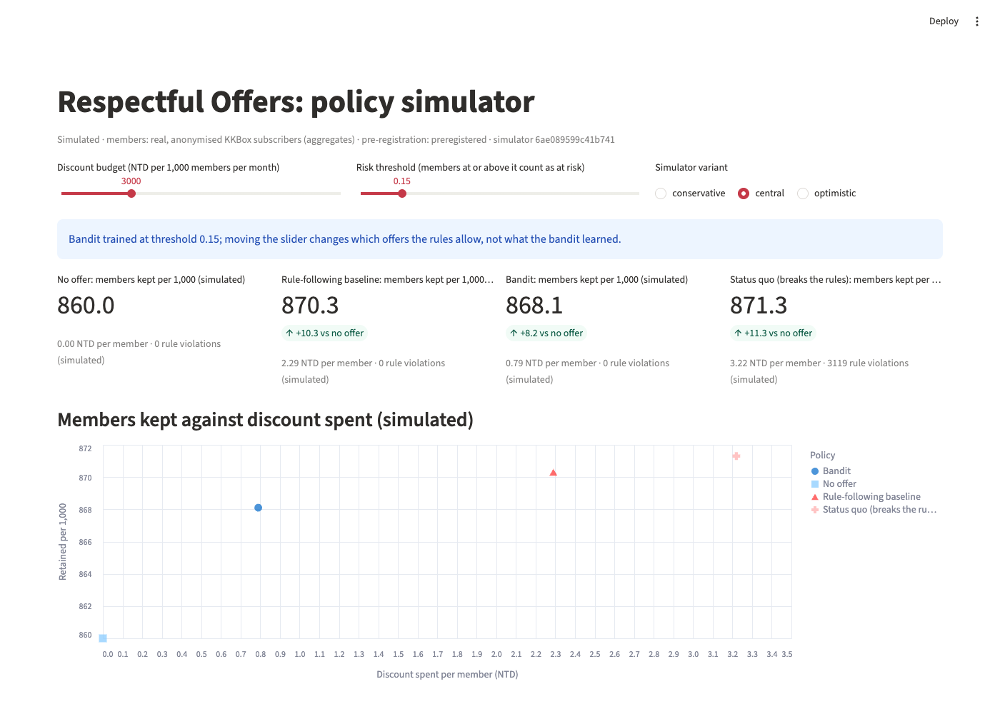

# Respectful Offers

[](https://github.com/biplob819/respectful-offers/actions/workflows/ci.yml)
[](https://pypi.org/project/respectful-offers/)
[](https://github.com/biplob819/respectful-offers/blob/main/pyproject.toml)
[](https://github.com/biplob819/respectful-offers/blob/main/LICENSE)

A subscription retention policy that predicts churn risk, chooses offers with a Thompson sampling bandit, and obeys two respect rules: **a declined offer stays declined**, and **members at risk see content before commerce**. It is evaluated offline, against a holdout, on real KKBox member behaviour with simulated offer responses.

<!-- headline:start -->


On 200,000 real KKBox members with **simulated** offer responses, the respectful bandit spent **97 NTD** of discount per extra member kept, against 211 NTD for the rule-following baseline and 289 NTD for the status quo, which breaks both respect rules (central variant). That was the pre-registered claim, more members kept per 1,000 NTD of discount than the baseline, and it holds in all three simulator variants (central +5.57, conservative +1.74, optimistic +9.36 members per 1,000 NTD; Holm-adjusted). In absolute terms the bandit keeps fewer extra members than the baseline (7.8 against 10.8 per 1,000, central): it leans on free content nudges and a cheaper plan instead of half-price months.

> **Simulated.** KKBox's data holds no offers. Members, features, churn labels and churn risk are real; how a member responds to an offer comes from a pre-registered simulator (`configs/simulator.yaml`), and every result is reported under all three of its variants. Read the conclusions as conditional on those assumptions.

```bash
pip install respectful-offers
offers report --example        # a full report from synthetic members, in seconds
offers data download && offers run --all   # the published run (Kaggle token needed)
```

Data: [WSDM Cup 2018, KKBox's churn prediction challenge](https://www.kaggle.com/competitions/kkbox-churn-prediction-challenge) on Kaggle, used under its rules for non-commercial research and education. No member data is in this repository.
<!-- headline:end -->

## Links

| | |
| --- | --- |
| **Results report** | [biplob819.github.io/respectful-offers](https://biplob819.github.io/respectful-offers/): every policy under every simulator variant, the respect audit, the holdout check, off-policy estimates beside the exact oracle, the churn model |
| **Live demo** | [respectful-offers.streamlit.app](https://respectful-offers.streamlit.app/): a policy simulator on an aggregates-only cube of the real run (passkey protected; run it locally without one, below) |
| **Case study** | [The project in five short sections](https://biplob819.github.io/respectful-offers/case-study.html), with a [90-second video script](https://github.com/biplob819/respectful-offers/blob/main/docs/site/video-script.md) |
| **PR/FAQ** | [One page, working backwards](https://biplob819.github.io/respectful-offers/prfaq.pdf) ([Markdown](https://github.com/biplob819/respectful-offers/blob/main/docs/site/prfaq.md)): what was built, the result, and what a real A/B test would add |
| **Decision review** | [Real decisions, read end to end](https://github.com/biplob819/respectful-offers/blob/main/results/kkbox/decision-review.md) before any number was published |
| **Published results** | [`results/kkbox/`](https://github.com/biplob819/respectful-offers/tree/main/results/kkbox/): summary, audit, lineage, churn model card |
| **Guides** | [Quickstart](https://github.com/biplob819/respectful-offers/blob/main/docs/guide/quickstart.md) · [Your own data](https://github.com/biplob819/respectful-offers/blob/main/docs/guide/own-data.md) · [Writing a simulator](https://github.com/biplob819/respectful-offers/blob/main/docs/guide/writing-a-simulator.md) · [How the respect rules work](https://github.com/biplob819/respectful-offers/blob/main/docs/guide/respect-rules.md) · [Reproduce the results](https://github.com/biplob819/respectful-offers/blob/main/docs/guide/reproduce.md) · [Privacy](https://github.com/biplob819/respectful-offers/blob/main/docs/guide/privacy.md) |
| **Product and design** | [PRD](https://github.com/biplob819/respectful-offers/blob/main/Respectful%20Offers%20PRD.md) · [Tech Spec](https://github.com/biplob819/respectful-offers/blob/main/Respectful%20Offers%20Tech%20Spec.md) · [Decision log](https://github.com/biplob819/respectful-offers/blob/main/docs/decisions.md) · [Lessons](https://github.com/biplob819/respectful-offers/blob/main/docs/lessons.md) · [Pre-registration](https://github.com/biplob819/respectful-offers/blob/main/docs/prereg.md) · [Data card](https://github.com/biplob819/respectful-offers/blob/main/DATA_CARD.md) · [Changelog](https://github.com/biplob819/respectful-offers/blob/main/changelog.md) |
| **Package** | [`respectful-offers` on PyPI](https://pypi.org/project/respectful-offers/): CLI `offers`, import `respectful_offers` |

## What it looks like

The results report (static HTML, no scripts, every simulated figure labelled):



The demo: move the discount budget and the risk threshold, switch simulator variants, and watch members kept, discount spent and the live respect audit:



## How it works

1. **Churn risk.** A gradient-boosted model, calibrated, trained on February 2017 members and evaluated on March (AUC 0.84 on real labels). Age and gender never enter it; they are only audited.
2. **Respect filter.** Before any policy chooses, the rules remove what it may not do: an action the member declined (R1), a commercial offer to an at-risk member who has not been offered content first (R2), anything for the holdout (R3). An independent auditor recomputes every rule from the decision log.
3. **Policies.** No offer, the status quo (discount everyone at risk, ignoring the rules), a rule-following baseline, a Thompson sampling bandit, and a segment oracle as the ceiling, all under one discount budget.
4. **Simulator.** Each member gets a hidden response segment (sure thing, persuadable, lost cause, sleeping dog) from a pre-registered mix that depends on their real features; three variants (conservative, central, optimistic) bracket the assumptions.
5. **Evaluation.** Every policy is rolled out on the same 200,000 members with common random numbers, compared with paired block-bootstrap intervals and a Holm correction; off-policy estimates (IPS, SNIPS, doubly robust) are checked against the simulator's exact answer.
6. **Release gates, in EvalKit's format.** `offers metrics` writes the results as [EvalKit](https://github.com/biplob819/evalkit)'s `metrics-1` file ([`results/kkbox/metrics.json`](https://github.com/biplob819/respectful-offers/blob/main/results/kkbox/metrics.json)), and CI gates every change on [`configs/gates.yaml`](https://github.com/biplob819/respectful-offers/blob/main/configs/gates.yaml): zero respect violations for every respectful policy, the pre-registered claim in every variant and a clean holdout check must hold; age-band disparity, churn-model quality and off-policy coverage warn. EvalKit's `evalkit gate` takes over from the local gate when it ships.

## Quickstart

```bash
pip install respectful-offers          # Python 3.11 to 3.13, any OS
offers doctor                          # checks Python, configs and data; prints no secrets
offers report --example                # a complete report from synthetic members
```

Then [run the whole pipeline on synthetic members](https://github.com/biplob819/respectful-offers/blob/main/docs/guide/quickstart.md), [bring your own member table](https://github.com/biplob819/respectful-offers/blob/main/docs/guide/own-data.md), or [reproduce the published results](https://github.com/biplob819/respectful-offers/blob/main/docs/guide/reproduce.md). To run the demo locally (no passkey needed on your own machine):

```bash
git clone https://github.com/biplob819/respectful-offers && cd respectful-offers
pip install -e ".[demo]"
streamlit run src/respectful_offers/demo/app.py -- --cube demo/cube.json
```

## How it was built

Node by node with a gated build harness: a node graph ([`docs/graph/`](https://github.com/biplob819/respectful-offers/tree/main/docs/graph/)), a capability catalog where every row is proven by named tests, twelve convergence gates per node, and a skeptical verifier that tries to disprove each node before it turns green. Every verifier finding and owner ruling is in the [decision log](https://github.com/biplob819/respectful-offers/blob/main/docs/decisions.md); every mistake worth not repeating is in [lessons](https://github.com/biplob819/respectful-offers/blob/main/docs/lessons.md). `python scripts/status.py` prints live progress. The longer story: [how it was built](https://github.com/biplob819/respectful-offers/blob/main/docs/how-i-built-it.md).

## Privacy

No telemetry. Nothing leaves your machine except the KKBox download you run yourself. KKBox data and member-level files are never committed; CI scans every push for them. See [privacy](https://github.com/biplob819/respectful-offers/blob/main/docs/guide/privacy.md) and the [data card](https://github.com/biplob819/respectful-offers/blob/main/DATA_CARD.md).

## Contributing

Issues and pull requests are welcome: see [CONTRIBUTING](https://github.com/biplob819/respectful-offers/blob/main/CONTRIBUTING.md), the [code of conduct](https://github.com/biplob819/respectful-offers/blob/main/CODE_OF_CONDUCT.md) and, for vulnerabilities, [SECURITY](https://github.com/biplob819/respectful-offers/blob/main/SECURITY.md). Licence: [MIT](https://github.com/biplob819/respectful-offers/blob/main/LICENSE).

## Glossary

- **Simulated.** KKBox's data holds no offers, so how a member responds to one comes from a stated, pre-registered simulator (`configs/simulator.yaml`). Members, features, churn labels and churn risk are real; every outcome that depends on an offer is simulated.
- **Response segments.** The simulator gives each member a hidden segment, as in uplift marketing. A *sure thing* is a member whose renewal an offer does not change: they still renew only at their own base rate (1 − churn risk), so "sure" does not mean "always renews", and a discount to them is wasted. A *persuadable* renews more when shown an offer; a *lost cause* leaves whatever you do; a *sleeping dog* is reminded to leave by an offer, even one they decline.
- **At risk.** Churn risk at or above the configured threshold (0.15).
- **R1, R2.** The respect rules: an action a member declined is not shown again (R1); members at risk see content before any commercial offer (R2).
- **Pre-registered.** The simulator's values were frozen by their sha256 before the real run (`docs/prereg.md`); a run on real data refuses any other file.
