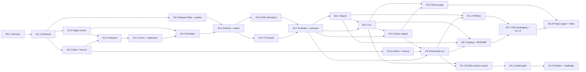

# Respectful Offers Tech Spec

Nov 15, 2026 · @Biplob Chakraborty · Companion to the [Respectful Offers PRD](Respectful%20Offers%20PRD.md)

The PRD says what the offer policy does and why. This spec says how it is built: the runtime pipeline, schemas, the response simulator, the respect filter and its independent auditor, the policies, off-policy evaluation and statistics, the demo, data and licensing, testing, and the build harness used to deliver it node by node. The harness is the same lean Kova adaptation used for EvalKit (`~/EvalKit`, EvalKit Tech Spec §11), with the gates retuned for a classical-ML project that makes no model API calls.

A loophole review of the PRD came before this spec. Its findings (C1–C6 critical, H1–H11 high, E1–E10 engineering gaps) are listed with what closes each one in Appendix A. The PRD changes they imply are listed in Appendix B; only the structural one is applied so far.

---

## 1. Design decisions

Each decision below seeds `docs/decisions.md` as D-1 to D-24. `OWNER D-n` marks a ruling the owner made in the §13 askme batch (2026-11-15).

| ID | Decision | Alternatives considered | Why |
| --- | --- | --- | --- |
| OWNER D-1 | The primary result is a multi-period **simulator rollout** of every policy on the same evaluation members under common random numbers (CRN). Inverse propensity scoring (IPS), self-normalised IPS (SNIPS) and doubly robust (DR) estimates are computed on period-1 logged decisions and **validated against the simulator's exact oracle value** (owner ruling, Q3) | OPE on simulated logs as the headline (PRD Flow A); rollouts only, no OPE | When the simulator generates both the logs and the truth, OPE can only recover the YAML (C1). Rules R1, R2 and R8 and the 90-day value are sequential, and single-step OPE cannot evaluate a policy whose allowed actions depend on its own past choices (C3). Validating OPE against a known truth turns the weakness into evidence that the estimators work, which is what a real A/B log would need |
| D-2 | The simulator draws a hidden **response segment** per member (sure thing, persuadable, lost cause, sleeping dog) from a mix that depends on real features (risk band × listening-trend band). Base renewal is 1 − the calibrated churn risk from the real model. Actions have an exposure effect and an acceptance effect per segment | The PRD's renewal-probability table per action × risk band | With a table keyed only on risk band, the optimal policy can be read straight from the YAML and the bandit has nothing to learn (C2). Sleeping dogs are what make "no offer" the right answer for some members, so R5 means something |
| D-3 | **Pre-registration.** The owner sets all three variants' values, `offers prereg` records the YAML's sha256 in `docs/prereg.md` and the decision log, and only then does `offers evaluate` run on real data. A changed YAML needs a new decision and a rerun of every variant. Runs with `--exploratory` are stamped and cannot be published | Set values freely on build day | Without a freeze, values can drift until the bandit wins (C6). Mirrors EvalKit's held-out rule (EvalKit §5 step 7) |
| D-4 | The respect filter is a pure function placed in front of every respectful policy. A separate **auditor** recomputes every rule from the decision log and member history, and does not import the filter (enforced by a test) | Trust counters kept by the filter itself | A filter that counts its own violations reports zero when it is wrong (H8). Same principle as EvalKit L-10: check against an independent source |
| D-5 | The reward is **net revenue per period**: renewal revenue after any discount. Headline outcomes are **incremental** against the no-offer policy on the same members (CRN), and cost is reported per incremental retained member | Renewal as the reward; raw retained counts; cost per retained member (PRD US2) | Optimising renewal always favours discounts (H1). Raw retained counts include members who would have stayed anyway, so deadweight discount spend disappears from the cost metric (H2) |
| D-6 | The bandit is **disjoint Bayesian linear Thompson sampling** (one ridge posterior per action, NumPy only). It is trained in simulation on a training cohort and then **frozen**. Its action probabilities come from Monte Carlo posterior draws | Beta-Bernoulli per context cell; LinUCB; online learning during evaluation; the Open Bandit Pipeline library | The reward is continuous, the model is easy to explain to a reviewer, and a frozen stochastic policy has well-defined propensities for OPE (H5). A small in-house module keeps dependencies light and the estimators inspectable |
| D-7 | The budget (R4) is a **per-period face-value pacer** applied after the policy chooses. Offers are admitted in priority order until the period's budget would be passed, and the rest are downgraded to the member's best free allowed action. The logging policy is an unbudgeted randomised pilot | Lagrangian or knapsack bandits; a budget counted on redemptions | Charging face value at send time guarantees spend stays within budget whatever members accept (H4). Keeping the budget out of the logger keeps its propensities exact and independent across members |
| D-8 | Cohorts come from **salted hash buckets of the member id** over the March cohort: holdout 10%, bandit training 30%, logging pilot 20%, evaluation 40% | A random split per run | Stable across runs and machines, checkable for leakage, and compatible with CRN (H6) |
| D-9 | The churn model trains on the **February** cohort, is calibrated by isotonic regression on a separate February fold, and is reported on **March**. Every feature is computed as of the first day of its label month. Both the churn model and the policies use an explicit **feature allow-list**, which excludes age, gender, city and registration channel | Random cross-validation; calibrate on the test month; a deny-list of age and gender | KKBox's churn label is defined by transactions after expiry, so anything from the label window leaks it (C4). Calibrating on the reporting month inflates its quality (H11). Risk feeds R2, so excluding protected attributes only from "decision features" is not enough, and city or channel can act as proxies (H7) |
| D-10 | A lean, synchronous **stage runner with a content-addressed artifact store**. Cache keys are built from stage, code version, input artifact hashes, config hash and seed. The design is copied from EvalKit D-2, not imported | Depending on `evalkit-harness`'s async runtime; a Makefile; Dagster or Hamilton | No model calls and no async work, but resume, exact rebuilds and lineage are still worth having (E3). Copying keeps this repo standalone |
| D-11 | Pydantic models for configs, summaries and the decision and outcome row contracts. DataFrames are checked against **column contracts** (dtype, nullability, ranges) at every stage boundary | One pydantic object per member; pandera | Around a million pydantic objects is slow, and column contracts give the same guarantees without another dependency |
| D-12 | Everything published holds **aggregates only**. The demo reads a **binned cohort cube** (counts per feature cell) and samples synthetic members from it, never member rows | "Cached member scores" in the demo (PRD) | The PRD's own risk mitigation says publish only aggregates. Per-member scores in a public demo break that (H9) |
| D-13 | Built with the **EvalKit lean Kova harness**: the same scripts ported (`harness_lib`, `verify_graph_eligibility`, `node_start`, `node_converge`, `status`, `secret_scan`), 12 gates with a respect-and-OPE gate in place of the judge gate, one builder plus a skeptical verifier, and live status from `scripts/status.py` | Tests only; full Kova | Owner's instruction: the same harness and methodology as EvalKit. As in EvalKit D-13, statusnow's `gather.py` does not read this repo, so status comes from the repo itself |
| D-14 | Repo `respectful-offers`, import `respectful_offers`, CLI `offers`, uv, hatchling and src layout. *Superseded in part by OWNER D-21:* the original "Python 3.12 only, Linux and macOS, no PyPI" no longer holds | — | — |
| OWNER D-15 | The report is a **static self-contained HTML** page (inline SVG, stdlib templates, Vega-Lite JSON alongside, as in EvalKit D-42). Every number that depends on the simulator carries a visible "Simulated" label, and all three variants' YAML is quoted byte for byte. It is hosted on GitHub Pages (owner ruling, Q4) | Cloudflare Pages (PRD); a notebook | Follows NFR1, and EvalKit moved to GitHub Pages for the same free public-repo hosting (EvalKit OWNER D-47) |
| D-16 | Intervals come from a **block bootstrap**: 1,000 hash-defined member blocks, 10,000 resamples, one seeded resample matrix shared by every policy and metric, paired across policies under CRN. A gap counts as separated only after a Holm correction per metric and variant (as in EvalKit D-36, D-37) | A member-level bootstrap; no correction | A member-level resample matrix over 200,000 members is too large. Members are independent, so resampling blocks is valid and cheap. Holm stops one lucky comparison from being called a win |
| OWNER D-17 | "Discount everyone at risk" appears twice: an unconstrained **status quo** reported with its violation counts, and a **rule-following baseline** through the filter. NFR2 becomes "zero violations for every respectful policy" (Q1) | Only the rule-following version | Filtering the baseline turns it into "nudge then discount" and erases the comparison the project exists to make (C5) |
| OWNER D-21 | **Open source, as EvalKit is.** Published on PyPI as `respectful-offers` (free, checked 15 Nov 2026) by GitHub trusted publishing on tag; Python 3.11–3.13 on Linux, macOS and Windows; anyone can run the policy on **their own subscription data** through a documented features table, with `offers init`, `doctor`, `report --example`; docs, community files, semver, no telemetry and no network calls outside the KKBox download | A project repo only (D-14 as first written) | Owner's instruction (2026-11-15): "It should be published as an open source project". A tool others can run on their own members is more useful than one tied to one Kaggle dataset |
| D-29 | The churn model and the DR reward model use scikit-learn's `HistGradientBoosting*` (gradient-boosted trees, the same family as LightGBM) instead of LightGBM | LightGBM (PRD) | LightGBM's macOS wheel needs Homebrew's `libomp` and fails to load on a clean machine (checked 15 Nov 2026); an open-source tool must work after a plain `pip install` on every OS, and scikit-learn wheels bundle OpenMP |
| D-24 | The real KKBox download, its verification and the licence ruling move from N1.2 to a new node **N1.5**, and the real-data results run becomes node **A2.8**. The pipeline is built and proven on the synthetic KKBox-format fixture; only A2.8 and what publishes its numbers (B2.3, P2.1, D3.1) wait for real data | Keep everything behind N1.2 | Owner-only steps (Kaggle credentials, rules, licence) should not block building and testing the whole pipeline |
| OWNER D-18 | R1 covers **every shown action**, the content nudge included: a nudge the member ignores is not repeated (Q2) | Commercial offers only | Matches the PRD's wording and is the simplest rule to audit |

---

## 2. Runtime pipeline

### 2.1 Stage contract

```python
class Stage(Generic[In, Out]):
    name: ClassVar[str]          # "features", "churn", "simulate", ...
    code_version: ClassVar[str]  # bump when the logic changes; invalidates the cache

    def cache_key(self, inputs: In, ctx: RunContext) -> str:
        # sha256 over canonical JSON of:
        # name, code_version, input artifact hashes, params() (instance attributes by default),
        # ctx.config_hash, ctx.simulator_hash, ctx.seed  (D-26)
        ...

    def run(self, inputs: In, ctx: RunContext) -> Out: ...
```

- **Store.** Artifacts (Parquet tables and JSON) are written atomically (temp file, then rename) to `.offers/store/<key[:2]>/<key>/`. The first writer wins (EvalKit L-18).
- **Lineage.** `runs/<run_id>/run.json` records each stage's key, parent keys, git SHA, config hash, simulator hash, seed and timings.
- **Cache hit.** A key already in the store skips the stage. Resuming is simply rerunning.
- **Version check.** A manifest hashes each stage class (including its base classes, schemas and attached constants, EvalKit L-13 and L-23). CI fails if the behaviour changes without a `code_version` bump.
- **Seeds.** One root seed in `RunConfig`. Each stage spawns its child seed from `SeedSequence(root, stage_name)`. Per-member random draws come from `SeedSequence(root, "crn", member_hash, period)`, so a member's draws do not depend on cohort order, sampling or which policy runs. This is what makes CRN hold.

### 2.2 Evaluation graph

```
Raw KKBox files ─▶ Ingest (DuckDB) ─▶ Features(as_of) ─▶ ChurnModel(Feb) ─▶ Calibrate(Feb fold) ─▶ Score(Mar cohort)
                                                                                                     │
                                                           CohortSplit (salted hash: holdout/train/logging/eval)
                                                                                                     │
                                          SimulatorConfig(variant, prereg hash) ─▶ LatentDraws (segment + CRN uniforms)
                                                                                                     │
         ┌────────────────────────────┬───────────────────────────────┬──────────────────────────────┤
         ▼                            ▼                               ▼                              ▼
 LoggingRollout (logging cohort,  TrainBandit (train cohort,     Rollouts (eval cohort, H=3,    Oracle (exact period-1
 period 1, uniform over allowed,  per-period updates)            every policy, CRN)             value per policy)
 exact propensities) → Logs       → FrozenPosterior ────────────▶       │                              │
         │                                                              │                              │
         └──────────▶ OPE (IPS, SNIPS, DR; period 1) ◀── policies ──────┤                              │
                              │                                         ▼                              │
                              │                               Audit (independent recomputation)        │
                              │                                         │                              │
                              └───────────────────┬─────────────────────┴──────────────────────────────┘
                                                  ▼
                       Aggregate (block bootstrap, paired, Holm, holdout check, budget sweep, disparity)
                                                  │
                                   ┌──────────────┼──────────────┐
                                   ▼              ▼              ▼
                                Report         PR/FAQ        DemoCube
```

The holdout cohort runs through the same rollout as the no-offer policy. Its realised retention is compared with the evaluation cohort's no-offer rollout as a consistency and leakage check (EVL-06).

### 2.3 Decision path for one period

```
for t in 1..H:                                         # H = 3 periods of 30 days
    S = active members at t                            # churned members have left
    allowed   = respect.allowed_actions(state[S], cfg) # R3 holdout, R1, R2; bool mask [n, 4]; no_offer always true
    probs     = policy.probabilities(ctx[S], allowed)  # zero outside allowed for respectful policies
    requested = policy.choose(probs, rng_t)
    chosen    = budget.admit(requested, policy.priority(ctx[S], requested), allowed, budget_t)   # R4
    log Decision(member, t, allowed, requested, chosen, probs[chosen], downgraded, face_value)
    outcome   = simulator.respond(state[S], chosen, draws[S, t])                                 # CRN
    state[S]  = update(state[S], chosen, outcome)      # declined, nudged, churned, plan multiplier
audit(decision_log, state_history, cfg)                # never imports respect.py
```

R8 holds by construction: there is one decision per active member per period, and the auditor still checks it.

### 2.4 Cohorts

| Cohort | Hash buckets (of 100) | Members (March cohort, approximate) | Used for |
| --- | --- | --- | --- |
| Holdout (R3) | 0–9 | 10% | Never offered anything; consistency check against the no-offer rollout |
| Bandit training | 10–39 | 30% | Simulated online training of the Thompson sampling posterior |
| Logging pilot | 40–59 | 20% | Period-1 randomised logging over allowed actions, input to OPE |
| Evaluation | 60–99 | 40%, sampled to `eval_sample` (default 200,000) | Rollouts of every policy under CRN; headline metrics |

The bucket is `sha256(holdout_salt + msno) mod 100`. The salt is fixed in config. A test proves the four cohorts are disjoint and cover every member.

### 2.5 Error rules

| Error | Behaviour | Exit code |
| --- | --- | --- |
| Raw file missing, wrong checksum or rules not acknowledged | Stop before any stage runs; the message names `offers data download` or `offers data verify` | 3 |
| Column contract broken at a stage boundary | Stop; the message names the stage, column and rule | 2 |
| Non-finite or negative probability, price, cost or budget | Error, never a silent pass (EvalKit L-12) | 2 |
| Simulator YAML hash differs from `docs/prereg.md` | Refuse unless `--exploratory`, which stamps every output "exploratory: not pre-registered" | 2 |
| A respectful policy breaks a rule, or the holdout leaks | The run completes and writes the audit, the report shows the failure, publishing refuses | 1 |
| Incremental retained ≤ 0 | Cost per incremental retained is `null` with the reason "no incremental members"; never divided | — |

---

## 3. Schemas (pydantic)

Results format v1. Every file carries `schema_version: "1.0"`. All models are frozen and deeply immutable: sequences are tuples, mappings are frozen, and non-finite floats are rejected (EvalKit L-8, L-9). Row models are the contracts for Parquet tables, and per-row validation runs on fixtures and samples. Full tables go through the column contracts (D-11).

```python
Action = Literal["no_offer", "content_nudge", "discount_1m", "plan_change"]
ACTIONS: tuple[Action, ...] = ("no_offer", "content_nudge", "discount_1m", "plan_change")  # column order of every mask
Response = Literal["accepted", "declined", "not_shown"]
PolicyName = Literal["holdout", "no_offer", "status_quo", "rule_following_baseline",
                     "bandit", "logging", "segment_oracle"]


class MemberFeatures(FrozenModel):         # features.parquet; built as of the cohort's label month
    msno: str                              # KKBox member id (already hashed by KKBox)
    cohort: Literal["feb", "mar"]
    as_of: date                            # every source event is strictly before this date
    tenure_days: int
    auto_renew: bool
    cancels_90d: int
    listening_trend_30d: float             # relative change in daily listening, last 30 d vs prior 30 d
    price_30d: float                       # NTD per 30 days, from the latest transaction
    plan_days: int
    churn_label: bool                      # from train.csv (feb) or train_v2.csv (mar)


class AuditAttributes(FrozenModel):        # audit_attributes.parquet; never joined into features
    msno: str
    age_band: Literal["<18", "18-24", "25-34", "35-44", "45+", "unknown"]   # KKBox `bd` is noisy
    gender: Literal["female", "male", "unknown"]


class MemberState(FrozenModel):            # member_states.parquet; one row per member × period
    msno: str
    period: int                            # 1..H
    active: bool
    in_holdout: bool
    churn_risk: float                      # calibrated probability
    risk_band: Literal["low", "medium", "high"]
    trend_band: Literal["declining", "stable"]
    declined: tuple[Action, ...]           # sorted; actions shown earlier and declined
    nudged: bool                           # a content nudge was shown in an earlier period (R2 "tried")
    price_30d: float
    plan_multiplier: float = 1.0           # < 1 after an accepted plan change


class Decision(FrozenModel):               # decisions.parquet
    run_id: str
    variant: str
    policy: PolicyName
    msno: str
    period: int
    allowed: tuple[Action, ...]            # after the respect filter; all four for the status quo
    requested: Action                      # the policy's choice before the budget pacer
    chosen: Action
    propensity: float                      # π(requested | context), before the budget (D-32): exact for logging, Monte Carlo for bandit, 1.0 if deterministic
    budget_downgraded: bool
    face_value: float                      # NTD charged against the period budget


class Outcome(FrozenModel):                # outcomes.parquet; every field is simulated
    run_id: str
    variant: str
    policy: PolicyName
    msno: str
    period: int
    response: Response
    renewed: bool
    revenue: float                         # NTD received for the next 30 days, net of discount
    discount_cost: float                   # NTD forgone against the list price


class Interval(FrozenModel):
    point: float
    lo: float
    hi: float


class PeriodSpend(FrozenModel):
    period: int
    budget: float
    face_value_committed: float            # ≤ budget, always (R4)
    realised_cost: float


class PolicySummary(FrozenModel):
    policy: PolicyName
    variant: str
    respectful: bool                       # False only for the status quo and the price-of-respect comparator
    n_members: int
    retained_per_1000: Interval
    incremental_retained_per_1000: Interval        # against no_offer on the same members (CRN)
    retained_per_1000_at_risk: Interval            # at the reference risk threshold
    ltv_proxy_per_member: Interval                 # 90-day net revenue, NTD
    discount_cost_total: float
    cost_per_incremental_retained: Interval | None # None when there are no incremental members
    offers_per_member_month: Interval
    max_offers_in_a_month: int                     # must be ≤ 1 (R8)
    no_offer_share: float                          # R5
    exploration_rate: float | None                 # R6; bandit only
    spend: tuple[PeriodSpend, ...]                 # R4
    violations: FrozenDict[str, int]               # R1, R2, R3, R7, R8, from the auditor


class OPEEstimate(FrozenModel):
    policy: PolicyName
    variant: str
    estimator: Literal["ips", "snips", "dr"]
    value: Interval                        # period-1 net revenue per member
    oracle: float                          # exact period-1 value from the simulator
    covered: bool                          # oracle inside value.lo..value.hi
    effective_sample_size: float


class Comparison(FrozenModel):
    variant: str
    metric: str
    a: PolicyName
    b: PolicyName
    diff: Interval
    p_value: float
    separated: bool                        # after Holm, per metric × variant


class ChurnReport(FrozenModel):
    auc: Interval                          # March cohort
    brier: Interval
    ece: float
    reliability: tuple[tuple[float, float, int], ...]   # (mean predicted, observed rate, n) per bin
    baseline_auc: Interval                 # two-feature logistic model (tenure, auto_renew)
    features: tuple[str, ...]              # equals the allow-list


class RunSummary(FrozenModel):
    schema_version: str
    run_id: str
    git_sha: str
    config_hash: str
    simulator_hash: str
    prereg_status: Literal["preregistered", "exploratory"]
    simulated: Literal[True]               # every outcome figure is simulated (NFR1)
    variants: tuple[str, ...]
    policies: tuple[PolicySummary, ...]
    ope: tuple[OPEEstimate, ...]
    comparisons: tuple[Comparison, ...]
    churn: ChurnReport
    holdout_check: FrozenDict[str, Interval]       # realised holdout vs eval no-offer retention, per variant
    disparity: FrozenDict[str, FrozenDict[str, Interval]]   # "policy.metric.attribute" → group → interval (D-34)
    started_at: datetime
    finished_at: datetime | None


class RunConfig(FrozenModel):
    seed: int
    holdout_salt: str
    cohort_buckets: FrozenDict[str, tuple[int, int]]  # holdout (0,10), train (10,40), logging (40,60), eval (60,100)
    eval_sample: int | None = 200_000
    horizon_periods: int = 3
    risk_threshold: float                  # R2 and the "at risk" definition
    budget_per_1000_per_period: float      # NTD face value; × cohort size at the start, constant as members leave (D-32)
    budget_sweep: tuple[float, ...]        # extra budget levels for the frontier chart
    variants: tuple[str, ...] = ("conservative", "central", "optimistic")
    decision_features: tuple[str, ...]     # the allow-list (D-9)
    ts_prior_precision: float
    ts_noise_variance: float
    ts_integration_nodes: int = 32           # per action, 16..256, exact choice probabilities (D-35)
    ts_support_floor: float = 0.001          # every allowed action keeps at least this probability
    bootstrap_blocks: int = 1_000
    bootstrap_resamples: int = 10_000
```

---

## 4. Interfaces and CLI

```python
def allowed_actions(state: StateFrame, cfg: RespectConfig) -> np.ndarray: ...  # bool [n, 4]; column 0 (no_offer) always True


class Policy(Protocol):
    name: PolicyName
    respectful: bool

    def probabilities(self, ctx: np.ndarray, allowed: np.ndarray) -> np.ndarray: ...  # [n, 4]; rows sum to 1; 0 outside allowed if respectful
    def choose(self, probs: np.ndarray, rng: np.random.Generator) -> np.ndarray: ...  # action index per row
    def priority(self, ctx: np.ndarray, chosen: np.ndarray) -> np.ndarray: ...        # budget admission order, higher first


class Simulator(Protocol):
    def respond(self, state: StateFrame, chosen: np.ndarray, draws: DrawFrame) -> OutcomeFrame: ...
    def expected_reward(self, state: StateFrame) -> np.ndarray: ...                   # [n, 4] exact E[net revenue | member, action]


def audit(decisions: pd.DataFrame, states: pd.DataFrame, cfg: RespectConfig) -> AuditReport: ...
def ips(logs: LogFrame, target: Policy) -> OPEEstimate: ...
def snips(logs: LogFrame, target: Policy) -> OPEEstimate: ...
def dr(logs: LogFrame, target: Policy, reward_model: RewardModel) -> OPEEstimate: ...
def simulate(budget: float, threshold: float, variant: str) -> DemoResult: ...      # demo; < 2 s at p95
```

**CLI contract.**

| Command | What it does | Needs raw data |
| --- | --- | --- |
| `offers data download` | Downloads the KKBox files through the Kaggle API with the owner's credentials (never printed) and records checksums | — |
| `offers data verify` | Checks sizes, checksums, columns, row counts and date ranges against `data/manifest.json` | Yes |
| `offers features` | Builds February and March feature tables from the raw files | Yes |
| `offers churn` | Trains, calibrates and reports the churn model; scores the March cohort | Yes |
| `offers prereg` | Validates `configs/simulator.yaml` and records its hash in `docs/prereg.md` | No |
| `offers simulate --variant central` | Draws latent responses, runs the logging pilot and trains the bandit | Yes |
| `offers evaluate --variant all` | Rollouts, OPE, audit and aggregate; writes `summary.json` | Yes |
| `offers report` | Builds the static report from `summary.json` | No |
| `offers run --all` | Every stage from raw files with one command (NFR4) | Yes |
| `offers init` | Writes `offers-run.yaml`, a simulator template, features and audit table templates and a README into a folder; never overwrites user files | No |
| `offers features --from-table members.csv` | Uses your own subscription data: validates a CSV or Parquet features table against the `MemberFeatures` contract instead of building from KKBox | No |
| `offers doctor` | Python version, data present and verified, prereg status, Kaggle credentials present (never printed) | No |
| `offers report --example` | Renders the report from the bundled synthetic run | No |
| `offers demo-cube` | Writes the aggregates-only cohort cube and frozen posteriors for the demo | Yes |

Every command takes `--json`. Exit codes:

| Code | Meaning |
| --- | --- |
| 0 | Finished; zero violations in every respectful policy; no holdout leak |
| 1 | Finished, but the audit failed: a respectful policy broke a rule or the holdout leaked |
| 2 | Configuration, contract or runtime error, including a pre-registration mismatch |
| 3 | Raw data missing or unverified; the message says which command fixes it |

A CLI owns its exit codes: every unexpected exception is caught at the top and mapped to 2 with a readable message (EvalKit L-29). A value of 0 is a value, never "unset" (a zero budget means no offers, not no cap).

---

## 5. Response simulator

### 5.1 Definitions

- **Period.** 30 days. **Horizon.** H = 3 periods, which is the PRD's 90-day value proxy.
- **Shown.** Any action other than `no_offer`.
- **Declined.** Shown and not accepted. A content nudge counts as declined when the member does not engage, and R1 then blocks further nudges (OWNER D-18).
- **Nudge tried (R2).** A content nudge was shown in an earlier period, whatever the response.
- **Content nudge.** KKBox is a music service, so the nudge is a personalised playlist or content prompt. The write-up says it stands in for "something to watch" (E10).
- **Prices.** Each member's `price_30d` in NTD comes from their latest transaction (`actual_amount_paid` ÷ `payment_plan_days` × 30). Figures are reported in NTD.

### 5.2 Response model

Each member *i* has a calibrated churn risk ρᵢ from the real model, so their base renewal probability is bᵢ = 1 − ρᵢ for every period. Their hidden segment sᵢ is drawn once from `segment_mix[risk_band][trend_band]`. In each period, given the chosen action *a*:

| Action | Response | Renewal this period | Cost |
| --- | --- | --- | --- |
| `no_offer` | not shown | Bernoulli(bᵢ) | 0 |
| `content_nudge` | engages with P = `acceptance[nudge][s]` | Bernoulli(clip(bᵢ + `exposure_effect[nudge][s]` + engaged × `acceptance_effect[nudge][s]`)) | `content_nudge.cost` (default 0) |
| `discount_1m` | accepts with P = `acceptance[discount_1m][s]` | Accepted: renews at the discount. Declined: Bernoulli(clip(bᵢ + `exposure_effect[discount_1m][s]`)) | Accepted: `discount_fraction` × price for one period |
| `plan_change` | accepts with P = `acceptance[plan_change][s]` | Accepted: renews on the cheaper plan. Declined: as for the discount | Accepted: (1 − `price_ratio`) × price for every remaining period |

Accepting a commercial offer means renewing on it, so a sure thing who accepts is pure deadweight: they would probably have renewed anyway. A sleeping dog's negative exposure effect means that showing an offer lowers their renewal even when they decline it. Churned members leave and receive no further decisions. The draws (segment, acceptance, renewal) come from the member's CRN stream, so every policy faces the same luck.

**Simplifications stated in the write-up:** base risk is constant across the three periods; effects last one period except the plan change; there is no social or seasonal effect; the bandit's reward is myopic (one period), so any cost of myopia shows up in the three-period rollout rather than being hidden.

### 5.3 `configs/simulator.yaml`

```yaml
schema_version: "1.0"
period_days: 30
horizon_periods: 3
currency: NTD
risk_bands: {cuts: [..., ...]}             # low < c1 ≤ medium < c2 ≤ high; owner sets
trend_bands: {cuts: [...]}                 # declining < c ≤ stable; owner sets
segments: [sure_thing, persuadable, lost_cause, sleeping_dog]
actions:
  content_nudge: {cost: 0}
  discount_1m:   {discount_fraction: ...}  # share of one period's price, charged only on acceptance
  plan_change:   {price_ratio: ...}        # new price ÷ current price for the rest of the horizon
variants:
  central:
    segment_mix:                           # each row sums to 1
      low.stable:       {sure_thing: ..., persuadable: ..., lost_cause: ..., sleeping_dog: ...}
      low.declining:    {...}
      medium.stable:    {...}
      medium.declining: {...}
      high.stable:      {...}
      high.declining:   {...}
    acceptance:          {content_nudge: {sure_thing: ..., ...}, discount_1m: {...}, plan_change: {...}}
    exposure_effect:     {content_nudge: {...}, discount_1m: {...}, plan_change: {...}}
    acceptance_effect:   {content_nudge: {...}}
  conservative: {...}                      # lower acceptance and uplift, more sleeping dogs
  optimistic:   {...}                      # higher acceptance and uplift, fewer sleeping dogs
```

The values stay blank in this spec on purpose. The owner sets them in node A2.2 through one askme sitting, with recommended starting values and the reasoning for each. They are then pre-registered (D-3), and the report quotes all three variants in full.

**Validation (SIM-06).** Every probability lies in [0, 1] and every mix sums to 1 within 1e-9. Every cell and segment is present. Effects run in their documented direction: persuadables gain, sleeping dogs lose under commercial offers, and sure things and lost causes stay near zero. Each variant is ordered as named (conservative ≤ central ≤ optimistic on acceptance and persuadable uplift). A YAML that breaks the direction rules is refused unless it sets `allow_unconventional: true`, which is then stamped on the report.

### 5.4 Oracle

Because the response model is known, `expected_reward(state)` gives the exact expected period-1 net revenue of each action for each member, averaged over the segment mix of the member's cell. The **period-1 oracle value** of any policy π is mean over members of Σₐ π(a | xᵢ) · E[r | xᵢ, a]. OPE estimates are scored against this value. The **three-period value** comes from the CRN rollout itself.

The **segment oracle** policy sees each member's true segment and picks the allowed action with the highest expected net revenue. It is plotted as a labelled upper bound ("knows what no real system can know"), so the bandit's gap to the ceiling is visible.

---

## 6. Policies and the respect layer

### 6.1 Respect filter (`policy/respect.py`)

| Rule | Implementation in `allowed_actions` |
| --- | --- |
| R3 holdout | Holdout members get only `no_offer` |
| R1 declined stays declined | Remove every action in `state.declined`, nudges included (OWNER D-18) |
| R2 content before commerce | If `churn_risk ≥ risk_threshold` and `not nudged`: allowed ∩ {`no_offer`, `content_nudge`} |
| R8 one offer per month | Structural: one decision per active member per period |
| R7 no protected attributes | Policy context columns must come from the allow-list (a baseline may use fewer, e.g. risk alone) and never name a protected or proxy attribute; checked at policy construction and again by the auditor, which refuses a policy whose context was not logged (D-25) |
| Always | `no_offer` is always allowed, so the allowed set is never empty |

### 6.2 Auditor (`policy/audit.py`)

The auditor reads `decisions.parquet` and `member_states.parquet` and recomputes, for every respectful policy and variant:

- R1: a chosen action that appears in that member's declines from earlier periods.
- R2: a commercial action for an at-risk member with no earlier nudge.
- R3: any non-null action to a holdout member, or any holdout member found in the training, logging or evaluation cohort.
- R7: the logged context schema contains a column outside the allow-list.
- R8: more than one decision per member per period.

It rebuilds each member's history from the outcome log itself rather than trusting `MemberState.declined`. A test asserts that `audit.py` imports nothing from `respect.py`. A mutation test plants three broken filters (one each for R1, R2 and R3) and asserts that the auditor catches every one (RSP-05).

### 6.3 Policies

| Policy | Respectful | Behaviour |
| --- | --- | --- |
| `holdout` | Yes | The holdout cohort; never offered anything |
| `no_offer` | Yes | Run on the evaluation cohort; the CRN counterfactual for every incremental metric |
| `status_quo` | **No** | "Discount everyone at risk": `discount_1m` when risk ≥ threshold, every period, ignoring R1 and R2. Reported with its violation counts as the comparator the project argues against (OWNER D-17) |
| `rule_following_baseline` | Yes | The same intent through the filter: nudge first, then discount, never re-offer a declined action |
| `bandit` | Yes | Frozen Thompson sampling (§6.4) over the allowed actions |
| `segment_oracle` | Yes | The upper bound from §5.4 |
| `logging` | Yes | Uniform over allowed actions; logging cohort, period 1 only; propensity 1/|allowed| |

The budget pacer applies to every policy except `holdout`, `no_offer` and `logging`, so cost comparisons are made at equal budget. The budget sweep (EVL-07) repeats the rollouts at each level in `budget_sweep` and draws retained-against-spend frontiers. Priority order: the bandit ranks by sampled value advantage over the best free allowed action, the baselines by churn risk, and the oracle by true expected advantage.

### 6.4 Thompson sampling bandit (`policy/bandit.py`)

- **Context** xᵢ: the allow-listed features (calibrated risk, auto-renew, tenure, cancellations, listening trend, price, nudged flag, declined flags; risk band is skipped because calibrated risk carries it), standardised with training-cohort statistics. The posterior records its column order and refuses a context of any other shape or order.
- **Model.** For each action, a Bayesian ridge posterior N(μₐ, Σₐ) on net revenue, with prior precision `ts_prior_precision` and noise variance `ts_noise_variance`.
- **Choice.** Draw θₐ ~ N(μₐ, Σₐ) for each allowed action, score θₐᵀxᵢ, and pick the highest. `no_offer` wins when every offer's sampled value is below it, which is R5.
- **Training.** Simulated online learning on the training cohort over H periods, with a batch posterior update after each period. The posterior after training is stored as an artifact and frozen for evaluation; the frozen flag travels with it, and a frozen posterior never updates.
- **Propensities.** π(a | xᵢ) is computed exactly, as the one-dimensional integral P(a wins) = ∫ Π_{b≠a} Φ_b dΦ_a over each member's independent normal scores, on a grid of `ts_integration_nodes` per action (worst error about 6e-4), then mixed with a uniform floor `ts_support_floor` over the allowed actions (D-35). They are used for OPE and for the exploration rate (the share of decisions where the drawn action is not the posterior-mean best, pooled over periods, R6).
- **Learning curve.** Period-1 oracle value of the posterior after each training period, against the segment oracle and no-offer (BND-05).

---

## 7. Evaluation and statistics

### 7.1 Rollout evaluation (primary)

For each variant, every policy in §6.3 runs H = 3 periods on the evaluation cohort with the same CRN draws, plus the holdout cohort under `holdout`. Because draws are shared, policy differences are paired member by member.

### 7.2 Off-policy evaluation (period 1, validated)

- **Logs.** Logging cohort, period 1: (xᵢ, allowed, aᵢ, μ(aᵢ | xᵢ) = 1/|allowedᵢ|, rᵢ).
- **IPS:** V̂ = (1/n) Σ π(aᵢ|xᵢ)/μ(aᵢ|xᵢ) · rᵢ. **SNIPS:** the same, normalised by Σ π/μ. **DR:** V̂ = (1/n) Σ [Σₐ π(a|xᵢ) q̂(xᵢ, a) + π(aᵢ|xᵢ)/μ(aᵢ|xᵢ) · (rᵢ − q̂(xᵢ, aᵢ))], with q̂ a per-action gradient-boosted regressor (scikit-learn `HistGradientBoostingRegressor`, D-29) cross-fitted over two folds.
- **Why period 1 only.** At period 1 no member has a history, so every policy's allowed set matches the logger's and the logger covers every action a target can take. From period 2 onwards histories diverge, and single-step OPE no longer applies. The estimators refuse a target from a later period (OPE-06).
- **Support.** Every target puts zero mass outside the logger's allowed set (asserted). Effective sample size (Σw)²/Σw² is reported.
- **Validation.** Each estimate is reported beside the exact oracle, computed on each member's own hidden segment (`expected_reward_by_segment`), with `covered`. In `pytest -m ope`, 200 replicate logging pilots on the 4,000-member fixture show, for no offer, the rule-following baseline, the segment oracle and a peaked stochastic target, that DR and SNIPS 95% interval coverage lies between 0.90 and 0.99 and the mean signed error is under 1 NTD per member (D-36).
- **Guards.** Logs must be the uniform pilot's (propensity exactly 1/|allowed|, aligned, distinct members); an interval needs at least 20 populated hash blocks and at most 1% undefined SNIPS resamples; a target with zero weight on every logged action is refused.

### 7.3 Intervals and comparisons

- Block bootstrap (D-16): each member's per-period outcomes are summed into one of 1,000 hash blocks; 10,000 resamples of blocks; percentile 95% intervals. One seeded resample matrix serves every policy, metric and variant.
- Ratios (cost per incremental retained) are bootstrapped as ratios of block sums. When the incremental interval does not lie above zero, the ratio's interval is unbounded, so it is `null`; resamples with no extra member count as unbounded, never dropped (D-38). More than 1% undefined resamples refuse an interval.
- Paired differences between policies on the same resamples, a two-sided bootstrap p-value, and Holm at 5% per metric and variant. Ties are reported as ties.
- The three variants are a **scenario analysis**, not an interval. The report never pools them.
- Floats that reach an output are summed with `math.fsum` (EvalKit L-27).

### 7.4 Metric definitions

| Metric | Definition | Denominator |
| --- | --- | --- |
| Retained per 1,000 | Members still active after period H | Every evaluation member, fixed whatever the threshold |
| Incremental retained per 1,000 | Retained under the policy minus retained under `no_offer`, on the same members | As above |
| Retained per 1,000 at risk (US1) | As above, restricted to members with risk ≥ the **reference** threshold in config; null below 30 at-risk members | At-risk members at the reference threshold, so the denominator does not move when the demo slider moves |
| Cost per incremental retained (US2) | Σ discount cost ÷ incremental retained members; null unless the incremental interval lies above zero | — |
| Members kept per discount dollar (pre-registered headline) | Incremental retained members per 1,000 NTD of discount, compared paired with Holm (D-38) | Discount cost |
| 90-day LTV proxy | Σ net revenue over H periods per member, NTD | Every evaluation member |
| Offer fatigue | Shown actions per active member-month; maximum per member-month | Active member-months |
| No-offer share (R5) | Share of decisions that are `no_offer` | Decisions |
| Exploration rate (R6) | Share of bandit decisions not equal to the posterior-mean best | Bandit decisions |
| Spend against budget (R4) | Face value committed (≤ budget each period) and realised cost per period; realised ≤ face over the horizon | Per period |
| Violations (R1, R2, R3, R7, R8) | Auditor counts | Per policy and variant |
| Churn model quality | AUC, Brier with CIs, ECE, reliability bins, two-feature baseline AUC | March cohort |
| Holdout consistency | Realised holdout retention minus eval `no_offer` retention; the interval should contain 0 | Per variant |
| Disparity (audit only) | Offer rate and retention by age band and gender for each respectful policy | Per group |

---

## 8. Demo architecture

- **Data.** `offers demo-cube` writes a cohort cube from the evaluation cohort of a pre-registered, audit-clean run: counts, means and spreads per cell of risk decile × trend band × auto-renew × tenure band × price band, with cells under 20 members merged, counts rounded to fives and values to three significant figures (D-43). It holds no member ids and no member rows (D-12). It ships with the frozen bandit posteriors and the three simulator variants.
- **Function.** `simulate(budget, threshold, variant)` samples 20,000 synthetic members from the cube with a fixed seed, then runs the vectorised three-period rollout for no-offer, the rule-following baseline, the bandit and the status quo. It recomputes the charts and the auditor's violation counts (zero for every respectful policy).
- **Threshold slider.** Moving the threshold changes R2's allowed sets. The bandit's posterior stays the one trained at the reference threshold, and the screen says "bandit trained at threshold X". Denominators use the reference threshold (§7.4).
- **Latency budget.** p95 under 2 s, the cold call included: about 1.1 s on an idle developer machine; tests hold a 3.5 s regression ceiling; the target on the deployed page's hardware is measured there (DEM-03, D-43).
- **Agreement.** At the reference settings, each policy's retained, paired incremental retained and offers per member-month fall within the full run's intervals widened by the demo's own sampling error (DMO-05, D-43). The demo's at-risk rate is not claimed to match.
- **Hosting.** A page in the shared Streamlit Community Cloud app `portfolio-demos`. It makes no network or model calls. It is protected by a passkey (OWNER D-48): only salted PBKDF2 hashes of the passkeys live in the app's Streamlit secrets, never in the repository, and the deployed page fails closed when none is set.
- **Honesty.** The footer is always visible: "Every outcome on this screen is simulated. Assumptions: [link to the YAML]."

---

## 9. Data and licensing

- **Source.** The WSDM Cup 2018 KKBox churn competition on Kaggle. The files used are `members_v3.csv`, `transactions.csv`, `transactions_v2.csv`, `user_logs.csv`, `user_logs_v2.csv`, `train.csv` and `train_v2.csv`.
- **Labels.** As defined by the competition: a member churns if they have no new valid subscription within 30 days of their membership expiring. `train.csv` covers February 2017 expiries and `train_v2.csv` covers March 2017.
- **As-of rule.** Features for a cohort use only events strictly before the first day of its label month (2017-02-01 for February, 2017-03-01 for March). The large `user_logs.csv` (about 30 GB) is streamed through DuckDB with date and member filters, never loaded whole. The spec assumes `user_logs_v2.csv` covers March 2017, which would put it inside the March label window and make it unusable for March features. N1.2 records the real date range of every file in `DATA_CARD.md`, and FEA-03 enforces the as-of rule whatever the ranges turn out to be.
- **Leakage test.** For every feature, the maximum source event date is before `as_of`. An oracle-feature probe adds "any transaction after as_of" as a feature and asserts that the leakage test catches it.
- **Licence gate.** Before anything derived is published, the owner reads the competition rules. The terms are quoted in `DATA_CARD.md` and the ruling is recorded as `OWNER D-n` (DAT-03). If the rules forbid publishing derived aggregates, the fallback is an openly licensed churn dataset, recorded as a decision (PRD risk table).
- **Never committed.** Raw files and any member-level derived table (features, scores, decisions, outcomes) live under `data/` and `.offers/`, both git-ignored. The raw-data gate fails if git tracks any file over 5 MB or any file containing a KKBox-shaped member id (44-character base64 ending in `=`).
- **Published.** Only `summary.json`, the report, the PR/FAQ and the demo cube are published, and each passes the publish scan (no member ids, no cell under 20 members).
- **Protected attributes.** Age (`bd`, which is noisy and has outliers) and gender live only in `audit_attributes.parquet`. A test proves that table is never joined into features or policy context.

---

## 10. Testing and observability

| Layer | What | Gate |
| --- | --- | --- |
| Unit | Filter rules, simulator response, pacer, TS update, estimators, metrics, bootstrap, cache key | `uv run pytest` |
| Property | Random histories never produce a forbidden action; `no_offer` is always allowed; probabilities sum to 1 and are zero outside allowed; bootstrap intervals contain the point estimate; cache keys are stable under dict key order | `pytest` with hypothesis |
| Contract | Every schema round-trips; v1 fixtures validate; column contracts reject bad frames; schema list compared with an independent list from this spec (EvalKit L-10) | `pytest -m contract` |
| Golden run | The full pipeline on the seeded **synthetic KKBox-shaped fixture** (5,000 members), from raw-format CSVs to `summary.json`, must match the stored file byte for byte and rerun entirely from cache | `pytest -m golden` |
| Respect | Auditor on every golden decision log; mutation test with three broken filters; R7 allow-list check; holdout leakage check | `pytest -m respect` |
| OPE | Estimator validation against the oracle over replicates (§7.2); unbiasedness on a toy problem with a closed-form answer | `pytest -m ope` |
| Leakage | As-of rule on every feature; the planted oracle-feature probe is caught | `pytest -m safety` |
| Static | Lint and types | `uv run ruff check`, `uv run pyright` |
| Build | Wheel builds and installs in a clean venv; `offers doctor` and `offers report --example` run with no raw data | `uv build` |
| Compatibility | Python 3.11, 3.12 and 3.13 on Linux, macOS and Windows (OWNER D-21) | CI matrix |
| Safety | Secret scan; raw-data scan; publish scan; no HTTP client imported outside `data/download.py` (NFR3); every text read and write names `encoding="utf-8"` (EvalKit L-32) | `pytest -m safety` plus the scanners |
| Performance | Demo `simulate` p95 within budget | `pytest -m perf` |
| Docs | Every command in the README and docs runs in a scripted fixture project (EvalKit L-40) | `pytest -m docs` |

**Determinism.** The gradient-boosted models (scikit-learn `HistGradientBoosting*`, D-29) run with a fixed `random_state` and no early-stopping split, under the versions locked in uv.lock. The golden summary rounds every float to 9 significant digits before writing, so it is byte-stable across machines. The golden test also runs on the CI's second OS.

**Observability.** Each run writes `runs/<run_id>/run.log` (JSON lines: stage, key, cache hit, rows in and out, seconds, error), and `summary.json` carries wall-clock time and stage timings. There is no spend ledger because nothing costs money (NFR3).

---

## 11. Build harness (lean Kova, as in EvalKit)

The project is built as a graph of **build nodes**. A node can start only when everything it depends on is green, and it turns green only when its proof passes every gate. The scripts are ported from `~/EvalKit/scripts/` with their self-tests, and the gate list is retuned in §11.6.

### 11.1 Repo layout

```
docs/graph/graph.md               # node tables: id, title, depends_on, verified_by, deliverable, stories
docs/graph/catalog.tsv            # cap_id, node, status, proof, note
specs/<node>-<slug>/spec.md       # goal, inputs, outputs, out of scope, constraints
specs/<node>-<slug>/criteria.md   # acceptance criteria, one block per capability row
specs/<node>-<slug>/tasks.md      # the capability loop checklist
specs/<node>-<slug>/RUN-STATE.md  # now, history, verifier rounds
docs/decisions.md                 # D-n, append-only; OWNER D-n for owner rulings
docs/lessons.md                   # L-n, seeded with the carried EvalKit lessons (§11.8)
docs/prereg.md                    # simulator hash and pre-registered success criteria
changelog.md                      # [TYPE] [NODE] — summary
DATA_CARD.md
scripts/harness_lib.py
scripts/verify_graph_eligibility.py
scripts/node_start.py
scripts/node_converge.py
scripts/status.py                 # live one-table build status
scripts/secret_scan.py
scripts/data_scan.py              # raw-data and publish scans
.harness/<node>/converge-*.txt    # every converge log

src/respectful_offers/
  schemas/   config.py rows.py summary.py contracts.py
  data/      download.py verify.py synthetic.py
  runtime/   stage.py store.py seeds.py versions.py
  features/  ingest.py build.py
  churn/     model.py calibrate.py
  sim/       config.py response.py oracle.py prereg.py
  policy/    respect.py audit.py budget.py baselines.py logging_policy.py bandit.py rollout.py
  ope/       estimators.py reward_model.py validate.py
  evaluate/  metrics.py stats.py aggregate.py
  report/    html.py charts.py
  demo/      cube.py simulate.py
  cli.py
```

Status vocabulary: `not-started | spec | building | green`.

### 11.2 Build graph: 25 nodes in five waves

**v0.1.0, the open-source release on PyPI with published results (every Must story, US1–US6, plus US8): 19 nodes.** W0.1, N1.1–N1.5, A2.1–A2.8, B2.1–B2.4, P2.1.
**Full scope, adding the demo, project page and video (US7): 22 nodes.**

| Node | Title | Depends on | Deliverable (what exists when it is green) | Stories |
| --- | --- | --- | --- | --- |
| **W0.1** | Repo and harness | — | Repo, uv project, CI, the ported harness scripts each with `--self-test`, decisions, lessons and changelog files | — |
| **N1.1** | Schemas and config | W0.1 | `respectful_offers.schemas` (§3), `RunConfig` and simulator config loaders, column contracts, results format v1 fixtures | US1, US5 |
| **N1.2** | Data contract, synthetic fixture and download tooling | N1.1 | `offers data download/verify` (tested against a fake Kaggle client), manifest format, synthetic KKBox-format fixture generator, raw-data gate, `DATA_CARD.md` | — |
| **N1.5** | KKBox acquisition and licence | N1.2 | Real KKBox files downloaded with the owner's credentials and verified; licence ruling recorded | — |
| **N1.3** | Stage runner and artifact store | N1.1 | Stage contract, content-addressed store, lineage, seed tree with CRN streams, version check | US1 |
| **N1.4** | Features | N1.2, N1.3 | DuckDB ingestion, as-of feature builder, February and March cohorts, allow-list, audit table, `offers features` | US1 |
| **A2.1** | Churn model and calibration | N1.4 | Gradient-boosted churn model (D-29), isotonic calibration, March report, risk scores and bands, `offers churn` | US1 |
| **A2.2** | Response simulator | A2.1, N1.3 | Segment response model, three variants set by the owner, CRN draws, oracle, `offers prereg` | US5 |
| **A2.3** | Respect filter and auditor | N1.1 | `allowed_actions`, holdout assignment, independent auditor, property and mutation tests | US3, US4 |
| **A2.4** | Policies, budget and rollout | A2.2, A2.3 | Policy protocol, baselines, pacer, logging pilot, segment oracle, vectorised rollout engine | US1, US2 |
| **A2.5** | Thompson sampling bandit | A2.4 | Linear TS, simulated training, frozen posterior, Monte Carlo propensities, learning curve | US1, US2 |
| **A2.6** | Off-policy estimators | A2.4 | IPS, SNIPS, DR with cross-fitted reward model, block bootstrap, validation against the oracle | US8 |
| **A2.7** | Evaluate and compare | A2.5, A2.6 | `offers evaluate`: rollouts per variant, metrics, paired comparisons, OPE beside oracle, audit, holdout check, budget sweep, disparity, `summary.json` | US1–US5, US8 |
| **A2.8** | Real-data results run | A2.7, N1.5 | The pre-registered pipeline run on real KKBox data for all three variants, with real decisions read end to end | US1–US5 |
| **B2.1** | Results report | A2.7 | Static HTML report with "Simulated" labels, YAML quoted, audit and calibration panels | US1, US2, US5, US8 |
| **B2.2** | CLI | A2.7, B2.1 | argparse CLI (§4, D-40), `doctor`, `report --example`, `run --all`, `init`, your own table, exit codes, `--json` | US1 |
| **B2.3** | Report deploy and README | B2.1, B2.2, A2.8 | README headline chart, report published on GitHub Pages, docs commands tested | US1 |
| **P2.1** | PR/FAQ | A2.8, B2.1 | One-page PR/FAQ, numbers templated from `summary.json`, PDF | US6 |
| **B2.4** | Open-source packaging and v0.1.0 | B2.3, P2.1 | PyPI `respectful-offers`, Python × OS CI matrix, docs (quickstart, your own data, simulator config), community files, history audit, data card, tag v0.1.0 | US6 |
| **D3.1** | Demo engine | A2.7, B2.2 | Aggregates-only cohort cube, `simulate()`, perf test, agreement with the full run; built on a synthetic run, rebuilt from real data in A2.8 (D-42) | US7 |
| **D3.2** | Demo page | D3.1, B2.2 | Streamlit page in `portfolio-demos` matching the PRD wireframe, deployed | US7 |
| **D3.3** | Project page and video | B2.4, D3.2 | Case study page and 90-second video script, numbers checked against `summary.json`, links resolve | — |
| **E4.1** | EvalKit metrics export (OWNER D-50) | A2.8, B2.2 | `offers metrics` writes EvalKit's `metrics-1` format from `summary.json`; `configs/gates.yaml` in EvalKit's gates format, checked by a local gate until EvalKit v0.3.0 ships `evalkit gate` | US6 |
| **E4.2** | Switch to `evalkit gate` (blocked on EvalKit v0.3.0) | E4.1 | CI gates with `evalkit gate` (an optional extra, never a runtime requirement), same verdict as the local gate; offline contract tests on EvalKit's public API, so EvalKit's canary runs this repo (`tests=auto`) | US6 |
| **E4.3** | Monitoring and improvement on EvalKit B5.7 (EvalKit v0.4.0) | E4.2 | `offers monitor` (binned feature shares, calibration, violations, cost, disparity per period; drift and alarms by EvalKit LED-01..05) and `offers challenge` (paired challenger vs champion under CRN, promotion by a pre-stated rule, recorded in EvalKit's ledger and the decision log); responses stay simulated | US6 |

Waves: **W0** harness → **N1** data and core → **A2/B2/P2** policy pipeline, report and release → **D3** demo and project page → **E4** EvalKit adoption (OWNER D-50). The results release, v0.1.0, ships at B2.4.

### 11.3 Node map, levels and build order



**Dependency levels.** A node can start once every node it depends on, all in earlier levels, is green.

| Level | Nodes |
| --- | --- |
| 0 | W0.1 |
| 1 | N1.1 |
| 2 | N1.3, N1.2, A2.3 |
| 3 | N1.4, N1.5 |
| 4 | A2.1 |
| 5 | A2.2 |
| 6 | A2.4 |
| 7 | A2.6, A2.5 |
| 8 | A2.7 |
| 9 | A2.8, B2.1 |
| 10 | B2.2, P2.1, D3.1 |
| 11 | B2.3, D3.2, E4.1 |
| 12 | B2.4, E4.2 |
| 13 | D3.3, E4.3 |

**Critical path to v0.1.0 (13 nodes):** W0.1 → N1.1 → N1.2 → N1.4 → A2.1 → A2.2 → A2.4 → A2.5 → A2.7 → B2.1 → B2.2 → B2.3 → B2.4. A2.8 (the real-data run) must also be green before B2.3, and N1.5 (the owner's Kaggle credentials and licence ruling) before A2.8. D3.3 adds a fourteenth node for full scope.

**Build order for a single builder.** Every node appears after all of its dependencies.

| # | Node | # | Node | # | Node |
| --- | --- | --- | --- | --- | --- |
| 1 | W0.1 | 9 | A2.4 | 17 | P2.1 |
| 2 | N1.1 | 10 | A2.6 | 18 | B2.3 |
| 3 | N1.3 | 11 | A2.5 | 19 | B2.4 → **v0.1.0 on PyPI** |
| 4 | N1.2 | 12 | A2.7 | 20 | D3.1 |
| 5 | A2.3 | 13 | N1.5 | 21 | D3.2 |
| 6 | N1.4 | 14 | A2.8 | 22 | D3.3 |
| 7 | A2.1 | 15 | B2.1 |  |  |
| 8 | A2.2 | 16 | B2.2 | 23 | E4.1 |
|  |  |  |  | 24 | E4.2 |
|  |  |  |  | 25 | E4.3 |

N1.3 comes before N1.2 because the runtime is the riskier design, and N1.2 waits on the owner's Kaggle credentials. A2.3 comes early because it needs only schemas and the respect rules are the project's thesis. A2.6 comes before A2.5 because validating the estimators against the oracle is the riskier method. N1.5 and A2.8 wait for the owner's Kaggle credentials and licence ruling (D-24); everything before them runs on the synthetic fixture.

### 11.4 Capability catalog

Each row becomes one line in `docs/graph/catalog.tsv` with status `not-started`. A node turns green when all of its rows are green. The trace column links each capability to the PRD (US, FR, NFR, R) or to a loophole finding (Appendix A). **123 capabilities**: 111 in v0.1.0 (REA-05 added by D-42), 12 in the demo and project page (DEM-04 added by OWNER D-48).

**W0.1 Repo and harness**

| Cap | Capability | Trace |
| --- | --- | --- |
| HAR-01 | uv project (Python ≥3.11), `respectful_offers` skeleton with `offers --version`, MIT licence, ruff pre-commit, `.gitattributes` forcing LF (EvalKit L-7) | NFR4 |
| HAR-02 | CI: lint, types, tests and build on every push, Python 3.11–3.13 on Linux, macOS and Windows, with least-privilege permissions | NFR4, OWNER D-21 |
| HAR-03 | `verify_graph_eligibility.py` ported: cycles, unknown dependencies, building ahead of a non-green dependency; self-test | D-13 |
| HAR-04 | `node_start.py` ported: eligibility, spec, criteria and tasks present, criteria cover every capability, `.base` written only by `--mark-building`; self-test | D-13 |
| HAR-05 | `node_converge.py` with the 12 gates of §11.6, every gate reported, each with a self-test that proves it can fail | D-13 |
| HAR-06 | Records: `graph.md` (20 nodes), `catalog.tsv` (116 rows), `decisions.md` with D-1 to D-21, `lessons.md` with the carried lessons, `changelog.md`, `docs/prereg.md` stub, `scripts/status.py` | D-13 |
| HAR-07 | Secret scan, raw-data scan and publish scan (`scripts/data_scan.py`) | NFR5, E5 |

**N1.1 Schemas and config**

| Cap | Capability | Trace |
| --- | --- | --- |
| SCH-01 | Row contracts: `MemberFeatures`, `AuditAttributes`, `MemberState`, `Decision`, `Outcome`, with `Action` and `Response` | FR4, FR6, H3, E1 |
| SCH-02 | Simulator config schema (§5.3) with structural validation: every cell and segment present, probabilities in range, mixes sum to 1 | FR3 |
| SCH-03 | `RunConfig` and its YAML loader with errors that name the file, key and rule | NFR4, E2 |
| SCH-04 | Summary schemas: `Interval`, `PeriodSpend`, `PolicySummary`, `OPEEstimate`, `Comparison`, `ChurnReport`, `RunSummary` with its stamps | FR7, FR8, NFR1 |
| SCH-05 | Column contracts (dtype, nullability, range) checked at stage boundaries | D-11 |
| SCH-06 | Results format v1: `schema_version`, fixtures, round-trip tests, deep immutability, no non-finite floats | NFR4 |

**N1.2 Data contract, synthetic fixture and download tooling**

| Cap | Capability | Trace |
| --- | --- | --- |
| DAT-01 | `offers data download` through the Kaggle API; credentials read from the environment and never printed; checksums in `data/manifest.json`; tested against a fake Kaggle client | FR1, E5 |
| DAT-02 | `offers data verify`: sizes, checksums, columns, row counts and per-file date ranges | NFR4, C4 |
| DAT-04 | `.gitignore` and the raw-data gate keep raw and member-level files out of git | NFR5 |
| DAT-05 | Seeded synthetic fixture generator producing KKBox-format CSVs (5,000 members) for tests, the golden run and `report --example` | NFR4 |
| DAT-06 | `DATA_CARD.md`: files, date ranges, cohorts, label definition, licence, what is published, protected-attribute handling | NFR5 |

**N1.5 KKBox acquisition and licence**

| Cap | Capability | Trace |
| --- | --- | --- |
| DAT-03 | Competition rules read; terms quoted in the data card; publishing ruled as `OWNER D-n` | NFR5 |
| DAT-07 | Real KKBox files downloaded with the owner's credentials and verified; real checksums, row counts and date ranges recorded in the manifest and data card | FR1, C4 |

**N1.3 Stage runner and artifact store**

| Cap | Capability | Trace |
| --- | --- | --- |
| RUN-01 | Stage contract and cache key | D-10 |
| RUN-02 | Content-addressed store with atomic, first-writer-wins writes | D-10 |
| RUN-03 | Lineage in `run.json` (keys, parents, git SHA, config and simulator hashes, timings) | NFR4, E3 |
| RUN-04 | Seed tree; per-member CRN streams keyed by member hash and period, independent of cohort order | D-1, NFR4 |
| RUN-05 | Resume by rerunning; behaviour-hash version check fails CI on an unbumped change | NFR4 |
| RUN-06 | `run.log` JSON lines and the run folder layout | NFR4 |

**N1.4 Features**

| Cap | Capability | Trace |
| --- | --- | --- |
| FEA-01 | DuckDB ingestion, streaming the large user-log file with date and member filters | FR1, E5 |
| FEA-02 | Feature builder as of a cutoff: tenure, auto-renew, cancels in 90 days, 30-day listening trend, price per 30 days, plan days | FR1 |
| FEA-03 | As-of guard and leakage test, including the planted oracle-feature probe | C4 |
| FEA-04 | February and March cohorts with labels from `train.csv` and `train_v2.csv` | FR2 |
| FEA-05 | Feature allow-list; age and gender only in the audit table, never joined | R7, H7 |
| FEA-06 | `offers features` rebuilds both cohorts from raw files with one command; feature summary statistics | NFR4 |
| FEA-07 | Your own data: `offers features --from-table` validates a user's CSV or Parquet features table against the `MemberFeatures` contract, with errors naming row and column | OWNER D-21 |

**A2.1 Churn model and calibration**

| Cap | Capability | Trace |
| --- | --- | --- |
| CHN-01 | Deterministic gradient-boosted churn model (scikit-learn `HistGradientBoostingClassifier`, D-29) on the February cohort | FR2 |
| CHN-02 | Isotonic calibration on a separate February fold | FR2, H11 |
| CHN-03 | March report: AUC and Brier with CIs, ECE, reliability bins | FR2, US8 |
| CHN-04 | Calibrated scores for the March cohort; risk and trend bands from config | FR2 |
| CHN-05 | Model card section: feature list equals the allow-list, importances, leakage checks | R7 |
| CHN-06 | Two-feature logistic baseline AUC reported beside the model | FR2 |

**A2.2 Response simulator**

| Cap | Capability | Trace |
| --- | --- | --- |
| SIM-01 | Segment response model (§5.2): base renewal from calibrated risk, exposure and acceptance effects, costs, horizon | FR3, C2 |
| SIM-02 | Three variants in `configs/simulator.yaml`, values set by the owner in one askme sitting | FR3, US5 |
| SIM-03 | Response draws from the CRN streams; identical luck across policies | D-1 |
| SIM-04 | Exact period-1 oracle (`expected_reward`) for any policy | C1 |
| SIM-05 | `offers prereg`; evaluate refuses an unregistered YAML unless `--exploratory`, which is stamped and unpublishable | C6 |
| SIM-06 | Direction and ordering validation; sanity test that no-offer renewal reproduces 1 − calibrated risk in expectation | C1, C2 |

**A2.3 Respect filter and auditor**

| Cap | Capability | Trace |
| --- | --- | --- |
| RSP-01 | `allowed_actions`: R3, R1, R2; `no_offer` always allowed | FR4, R1–R3 |
| RSP-02 | One decision per member per period by construction (R8) | R8 |
| RSP-03 | Holdout assignment by salted hash; cohorts disjoint and complete | R3, H6 |
| RSP-04 | Independent auditor for R1, R2, R3, R7 and R8 from the logs; never imports the filter | NFR2, H8 |
| RSP-05 | Property tests over random histories; mutation test with three broken filters | NFR2, H8 |
| RSP-06 | R7 check: policy context columns equal the allow-list | R7, H7 |

**A2.4 Policies, budget and rollout**

| Cap | Capability | Trace |
| --- | --- | --- |
| POL-01 | `Policy` protocol: probabilities zero outside allowed for respectful policies | FR5, FR6 |
| POL-02 | `no_offer`, `status_quo` (not respectful, violations reported) and `rule_following_baseline` | FR8, C5 |
| POL-03 | Face-value budget pacer per period with priority order and downgrade to the best free allowed action | R4, H4 |
| POL-04 | Logging pilot: uniform over allowed, exact propensities, period 1 on the logging cohort | FR6 |
| POL-05 | Segment-oracle reference policy, labelled as an upper bound | C1 |
| POL-06 | Vectorised H-period rollout engine with state updates and decision and outcome logs | FR8, C3 |

**A2.5 Thompson sampling bandit**

| Cap | Capability | Trace |
| --- | --- | --- |
| BND-01 | Disjoint Bayesian linear TS on net revenue, prior from config | FR5, H1 |
| BND-02 | Simulated training on the training cohort with per-period updates; frozen posterior artifact | FR5, H5 |
| BND-03 | Monte Carlo action probabilities for OPE and the exploration rate | FR7, R6, H5 |
| BND-04 | R5 through the sampled-value argmax; no-offer share reported | R5 |
| BND-05 | Learning curve against no-offer and the segment oracle | US1 |
| BND-06 | Context built only from allow-listed features (RSP-06 hook) | R7 |

**A2.6 Off-policy estimators**

| Cap | Capability | Trace |
| --- | --- | --- |
| OPE-01 | IPS and SNIPS with exact logging propensities | FR7 |
| OPE-02 | DR with a two-fold cross-fitted per-action reward model | FR7 |
| OPE-03 | Block bootstrap 95% intervals | FR7, US8 |
| OPE-04 | Validation against the oracle: bias and coverage over 200 replicates | C1 |
| OPE-05 | Support assertion and effective sample size | C3 |
| OPE-06 | Scope guard: period-1 targets only | C3 |

**A2.7 Evaluate and compare**

| Cap | Capability | Trace |
| --- | --- | --- |
| EVL-01 | Rollouts of every policy per variant on the evaluation cohort under CRN, plus the holdout cohort | FR8, US1, US5 |
| EVL-02 | Every metric in §7.4 | US1, US2, H2 |
| EVL-03 | Paired block bootstrap and Holm separation | US8, D-16 |
| EVL-04 | OPE estimates of every policy at period 1 beside the oracle | FR7, C1 |
| EVL-05 | Audit: zero violations for every respectful policy or exit 1; status quo violations reported | NFR2 |
| EVL-06 | Holdout consistency and leakage check | R3, H6 |
| EVL-07 | Budget sweep and retained-against-spend frontiers | US2, US7 |
| EVL-08 | Disparity audit by age band and gender (audit only, never a decision input) | H7 |
| EVL-09 | `summary.json` with `prereg_status`, `simulated` and hashes; refuses stale or misaligned inputs | NFR1, C6 |

**A2.8 Real-data results run**

| Cap | Capability | Trace |
| --- | --- | --- |
| REA-01 | `offers run --all` on real KKBox data for all three pre-registered variants; `summary.json` stamped `preregistered` | US1–US5, C6 |
| REA-02 | A sample of real decisions read end to end (member, allowed set, choice, response, renewal) and every failure reason confirmed before any number is reported (L-11) | L-11 |
| REA-03 | Churn model report and leakage probe re-run on the real cohorts | FR2, C4 |
| REA-04 | The run's published outputs pass the publish scan and respect the DAT-03 licence ruling | NFR5 |
| REA-05 | The demo cube rebuilt from the real run with `offers demo-cube`, and the demo's agreement with the full run (DMO-05) re-checked on real data | D-42 |

**B2.1 Results report**

| Cap | Capability | Trace |
| --- | --- | --- |
| RPT-01 | Static self-contained HTML covering all three variants | FR8 |
| RPT-02 | Charts: retained-against-spend frontier with CIs, policy table, variant comparison, OPE against oracle, reliability plot, learning curve | US1, US2, US5 |
| RPT-03 | "Simulated" label on every simulator-dependent figure, checked by parsing the rendered HTML | NFR1, E8 |
| RPT-04 | All three variants' YAML quoted byte for byte | NFR1 |
| RPT-05 | Audit panel, holdout check, disparity table, churn model card | NFR2, R3 |
| RPT-06 | Accessibility (not colour alone, keyboard), pre-registration stamp, rendered from real run output in a test (EvalKit L-28, L-38) | NFR1 |

**B2.2 CLI**

| Cap | Capability | Trace |
| --- | --- | --- |
| CLI-01 | `offers data`, `features`, `churn`, `prereg`, `simulate`, `evaluate`, `report` | Flow A |
| CLI-02 | `offers doctor` | NFR4 |
| CLI-03 | `offers report --example` from the bundled synthetic run, never overwriting a real run folder (EvalKit L-30) | NFR4 |
| CLI-04 | Exit codes 0–3 and `--json` on every command; top-level exception mapping | E4 |
| CLI-05 | `offers run --all` from raw files with one command | NFR4 |
| CLI-06 | `offers init` scaffolds a project folder and never overwrites user files (EvalKit L-30) | OWNER D-21 |

**B2.3 Report deploy and README**

| Cap | Capability | Trace |
| --- | --- | --- |
| REL-01 | README opening: one chart, three sentences, the "simulated" caveat, a three-line reproduce snippet, KKBox credit | NFR1 |
| REL-02 | Report published from a directory that passes the publish scan, on GitHub Pages | NFR5, D-15 |
| REL-03 | Every documented command runs in a scripted fixture project | NFR4 |

**P2.1 PR/FAQ**

| Cap | Capability | Trace |
| --- | --- | --- |
| PRF-01 | One-page press release and FAQ in Markdown, built to PDF | FR9, US6 |
| PRF-02 | Every number templated from `summary.json`; a test fails on any drift | NFR1 |
| PRF-03 | FAQ covers what a real A/B test would add, why a holdout, why DR, and why the rules sit outside learning | FR9 |
| PRF-04 | "Simulated" labelling; conclusions stated per variant and as conditional | NFR1 |

**B2.4 Open-source packaging and v0.1.0**

| Cap | Capability | Trace |
| --- | --- | --- |
| OSS-01 | Full history audit for raw data, member-level files and secrets before the repo goes public | NFR5 |
| OSS-02 | Decision log, data card, "how I built it" note and PRD link in the repo | Deliverables |
| OSS-03 | Tag v0.1.0; CI green on the tag; results reproduce from a clean clone plus the raw files | NFR4 |
| OSS-04 | Published artifacts re-checked against the DAT-03 licence ruling | NFR5 |
| OSS-05 | Distribution `respectful-offers` on PyPI, CLI `offers`, import `respectful_offers`; release by GitHub trusted publishing on tag | OWNER D-21 |
| OSS-06 | `uvx --from respectful-offers offers doctor` and `offers report --example` smoke test on every OS after release | OWNER D-21 |
| OSS-07 | Docs: quickstart (first result in under 5 minutes on the synthetic example), using your own data, writing a simulator config, how the respect rules work, reproducing the published results | OWNER D-21 |
| OSS-08 | CONTRIBUTING, SECURITY, CODE_OF_CONDUCT, issue and PR templates, semver and versioning policy | OWNER D-21 |
| OSS-09 | Privacy statement: no telemetry; nothing leaves the machine except the KKBox download the user runs | OWNER D-21, NFR3 |

**D3.1 Demo engine**

| Cap | Capability | Trace |
| --- | --- | --- |
| DMO-01 | Aggregates-only cohort cube with small-cell merging | D-12, H9 |
| DMO-02 | `simulate(budget, threshold, variant)` on 20,000 synthetic members with frozen posteriors | FR10, US7 |
| DMO-03 | p95 latency test within budget | US7 |
| DMO-04 | Live auditor counts shown, zero for every respectful policy | US7, NFR2 |
| DMO-05 | Demo figures at the reference settings fall within the full run's intervals | NFR1, H10 |

**D3.2 Demo page**

| Cap | Capability | Trace |
| --- | --- | --- |
| DEM-01 | Streamlit page in `portfolio-demos`: sliders, variant switch, charts, holdout card, simulated footer | FR10 |
| DEM-02 | Central variant by default; no network or model calls | NFR3 |
| DEM-03 | Deployed with the cube and posteriors as files | FR10 |
| DEM-04 | Deployed page behind a passkey: salted hashes in the app's secrets, revocable per passkey, lockout and throttle, fails closed (OWNER D-48) | FR10, NFR3 |

**D3.3 Project page and video**

| Cap | Capability | Trace |
| --- | --- | --- |
| PAG-01 | Case study page in the shared template, numbers checked against `summary.json` | Deliverables |
| PAG-02 | 90-second video script on the two rules and the result, numbers checked | Deliverables |
| PAG-03 | Every link resolves (report, PR/FAQ, demo, repo) | Deliverables |

**E4.1 EvalKit metrics export (OWNER D-50, D-51)**

| Cap | Capability | Trace |
| --- | --- | --- |
| EVK-01 | `offers metrics` writes `summary.json` as EvalKit's frozen `metrics-1` file: policy × variant labels, NTD unit, the run's block-bootstrap intervals carried exactly with `ci_method`, violations as counts per rule, `simulated: true`, no member ids; a validator applies every `metrics-1` rule | OWNER D-50 |
| EVK-02 | `configs/gates.yaml` in EvalKit's gates format (respectful policies' violations `== 0`, the pre-registered claim, OPE coverage, age-band disparity); `scripts/gate.py` evaluates it with EvalKit's exit codes until `evalkit gate` ships; the committed `results/kkbox/metrics.json` and `gate.json` are checked in CI | OWNER D-50 |

**E4.2 Switch to `evalkit gate` (blocked on EvalKit v0.3.0, B5.4)**

| Cap | Capability | Trace |
| --- | --- | --- |
| EVK-03 | CI gates with `evalkit gate` (evalkit-harness ≥ 0.4.0 since E4.3, as an optional extra, never a runtime requirement); same verdict as `scripts/gate.py` on the committed files and on every planted defect; EvalKit's metrics-1 loader and `validate_metrics1` agree | OWNER D-50 |
| EVK-04 | Offline contract tests on EvalKit's public API only, which EvalKit's canary runs; the registry row flips to `tests=auto` in EvalKit's own build (D-61 rule 4) | OWNER D-50, EvalKit D-61 |

**E4.3 Monitoring and improvement on EvalKit B5.7 (EvalKit v0.4.0, D-59)**

| Cap | Capability | Trace |
| --- | --- | --- |
| MON-01 | `offers monitor` (`export`, `drift`, `check`): per period, `metrics-1` with binned feature shares (no non-empty bin under 30 members, a constant feature kept in below/equal/above bins), calibration on ten equal-width bins; PSI, calibration deltas and alarms computed by EvalKit (`evalkit.drift`, LED-04, LED-05) at `configs/drift.yaml` (every severity warn) and recorded in its run history (LED-01, LED-02); outcome checks (violations, claim, cost, disparity) fail; outcomes stay simulated | OWNER D-50, D-56, D-59 |
| MON-02 | `offers challenge`: challenger vs champion on the same members under CRN, paired claim comparison with Holm, `evalkit compare` deltas; promotion only by the pre-stated rule (claim improves in every variant, zero violations, no fail alarm); every challenge opened in EvalKit's experiment ledger (LED-03) before any rollout and closed with EvalKit's unpaired compare, and recorded in `docs/decisions.md` | OWNER D-50, D-58, D-59 |

### 11.5 Node lifecycle

| Step | What happens | Script or artifact |
| --- | --- | --- |
| 0. Spec | Write `spec.md` and `criteria.md`. Grep `decisions.md` first, then batch any owner questions into one askme sitting | `specs/<node>/` |
| 1. Start | Check eligibility (every dependency green, no cycles), spec and criteria present, criteria covering every capability | `scripts/node_start.py <node>`; exit 1 means don't start; `--mark-building` flips rows |
| 2. Tests first | Failing tests for each criterion across the five proof dimensions | `tests/` |
| 3. Build | Implement until the tests pass | code |
| 4. Converge twice | Full gate set twice in a row with clean caches | `scripts/node_converge.py <node>` |
| 5. Skeptical verify | A fresh-context verifier agent tries to disprove each criterion. Findings are fixed or ruled on in `decisions.md`, and every fix becomes a lesson | Verifier rounds in `RUN-STATE.md` |
| 6. Flip green | Proof cells in `catalog.tsv`, a changelog line, lessons, one commit per node, then read CI before the next node (EvalKit L-20) | `catalog.tsv`, `changelog.md`, `lessons.md` |

**The five proof dimensions:**

| Dimension | Proof |
| --- | --- |
| Logical | Unit tests for the node's behaviour (never n/a) |
| Contract | Schema, column contract, CLI or public interface tests |
| Golden run | The synthetic end-to-end fixture still matches byte for byte (n/a with a reason before A2.7) |
| Reproducibility | Same seed and inputs give identical artifacts; cache keys stable; CRN draws independent of order |
| Respect and honesty | Zero violations by the independent auditor, "Simulated" labels, no member-level data in anything published, no protected attributes in decisions |

**Proof cell format:** `logical=<test file>›"<test>"; contract=…; golden=…; repro=…; respect=…`. Each named test must resolve through `ast` to a real, unskipped `def test_*` (EvalKit L-2), and an n/a needs a reason of at least ten characters.

### 11.6 Gates in `node_converge.py`

Every gate runs and is reported even after an earlier one fails. Every gate ships a `--self-test` that feeds it bad input and requires the planted defect's identity in the output (EvalKit L-1, L-4).

1. Node claims work: at least one catalog row for the node is `building` or `green`.
2. Graph eligibility.
3. Proof claims resolve.
4. `uv run ruff check`.
5. `uv run pyright`.
6. `uv run pytest` (unit, property, contract).
7. `pytest -m golden` (SKIP until A2.7, never PASS with no tests).
8. `pytest -m "respect or ope"` (from A2.3 onwards; replaces EvalKit's judge gate).
9. Safety: `pytest -m safety`, the secret scan, the raw-data scan and the publish scan.
10. `uv build`, then install the wheel in a clean venv and run the smoke commands (`offers --version`; from B2.2, also `offers doctor` and `offers report --example`).
11. Changed code has changed tests since the node's `.base`.
12. Records: changelog entry, criteria cover every row, `RUN-STATE.md` present, docs fresh.

### 11.7 Roles

- **Builder** (Claude Code main session): writes specs, tests and code. Commits one node at a time and pushes only with the owner's approval.
- **Verifier** (a fresh-context subagent told to be skeptical): tries to disprove each criterion. It sees only the criteria, the code and the gate output, never the builder's reasoning. It runs with `UV_PROJECT_ENVIRONMENT` pointing at a private scratch folder (EvalKit L-15).
- **Owner:** rules on scope, simulator values, licence, destructive changes and trade-offs through batched askme questions with the recommended option first. Rulings are recorded as `OWNER D-n`.

**Dropped from Kova, as in EvalKit:** lanes and the integrator, the EM ruling agent, Playwright and layout gates, capture freshness, migrations and RLS gates. **Dropped from EvalKit:** the judge gate, spend ledger, cost estimate and batch handling, since nothing calls a paid API.

### 11.8 Lessons carried from EvalKit

These seed `docs/lessons.md` so the verifier's earlier findings become day-one rules rather than rediscoveries.

| EvalKit lesson | Rule here | Where it applies |
| --- | --- | --- |
| L-1, L-4 | A gate that has never failed is unchecked; self-tests require the planted defect's identity | Every gate |
| L-2 | Proofs resolve to real, unskipped tests | Gate 3 |
| L-8, L-9 | Deep immutability; no non-finite floats | N1.1 |
| L-10 | Contract tests compare against an independent list | N1.1, the auditor (D-4) |
| L-12 | Every money and probability value is checked finite and non-negative; a bad value is an error | Pacer, simulator |
| L-16 | Docs say what is true now and name the node that will make the rest true | Data card, README |
| L-25, L-26 | Never default a missing value; pin statistics with asymmetric hand-computed cases and at least three groups so Holm actually bites | A2.6, A2.7 |
| L-27 | `math.fsum` for every float total that reaches an output | A2.7 |
| L-35 | Guard by allow-list, not by matching the forbidden thing | Feature allow-list (D-9) |
| L-36 | Bootstrap at the level where the statistic is defined; infrastructure failures are exclusions, never outcomes | A2.6, A2.7 |
| L-37, L-38 | Before trusting a headline, read a sample of real decisions end to end (member, allowed set, choice, response, renewal) and confirm each failure reason is real | A2.7 first real run |
| L-40 | A test of a doc or workflow executes it, never searches its text | B2.3 |

---

## 12. Technical risks

| Risk | Mitigation |
| --- | --- |
| The simulator still drives the conclusion | Three pre-registered variants, segment heterogeneity the bandit must learn, the oracle ceiling plotted, conclusions stated per variant and as conditional, YAML quoted in full |
| Rules about what the simulator "should" show bias the values | Values set before any evaluation on real data and frozen by hash (D-3); exploratory runs cannot be published |
| Thompson sampling barely beats the rule-following baseline | That is a reportable finding. The pre-registered criterion is phrased so either answer is publishable, and the report explains the result through the learning curve and the oracle gap |
| KKBox file date ranges differ from the assumptions in §9 | N1.2 records the real ranges and FEA-03 enforces the as-of rule against whatever they are |
| The 30 GB user-log file is slow on a laptop | DuckDB streams it with filters; a cached filtered extract is a stage artifact, so the scan happens once |
| Gradient-boosted model output drifts across OS or versions and breaks the golden run | Deterministic settings, a pinned version, 9-significant-digit rounding in the golden summary, golden test on both CI OSes |
| The block bootstrap understates uncertainty | Members are independent and blocks are random hashes; a test compares block and member-level intervals on the fixture |
| The myopic bandit undervalues nudges that unlock later options | The three-period rollout measures the real outcome; the write-up names the limitation and the segment oracle shows the headroom |
| The licence forbids publishing derived aggregates | Read the rules in N1.2 before any derived work is published; the fallback dataset is a recorded decision |
| Harness overhead exceeds value | Single builder, 12 gates, no lanes; stop adding process unless a lesson demands it |

---

## 13. Owner questions and prerequisites

**Askme batch, ruled 2026-11-15.** The owner chose the recommended option on all four.

| # | Question | Ruling | Alternative not taken |
| --- | --- | --- | --- |
| Q1 | How should "discount everyone at risk" appear? | OWNER D-17: as an unconstrained status quo with its violation counts, plus a rule-following baseline. NFR2 becomes "zero violations for every respectful policy" | Only the rule-following version, so every run has zero violations |
| Q2 | Does R1 cover the content nudge? | OWNER D-18: yes, every shown action, as the PRD's wording says, so an ignored nudge is not repeated | Commercial offers only; nudges can repeat once a month |
| Q3 | What is the headline evidence? | OWNER D-1: three-period rollouts under CRN, with OPE validated against the oracle at period 1 | OPE estimates on simulated logs as the headline, as in PRD Flow A |
| Q4 | Where is the report hosted? | OWNER D-15: GitHub Pages, as EvalKit moved to (EvalKit OWNER D-47) | Cloudflare Pages, as the PRD says |

**Prerequisites only the owner can do.**

- Kaggle account and API token in the environment, and the competition rules accepted on Kaggle, before N1.2.
- Read the competition rules for the DAT-03 licence ruling.
- Set the simulator values in A2.2 (askme with recommended starting values) before pre-registration.
- Public repo `biplob819/respectful-offers` exists (created 2026-11-15).
- Before B2.4: add a PyPI trusted publisher for `respectful-offers` (repo `biplob819/respectful-offers`, workflow `release.yml`, environment `pypi`).

---

## Appendix A: Loophole traceability

Findings from the PRD review, with what closes each one. C = critical, H = high, E = engineering gap.

| Finding | Problem | Closed by |
| --- | --- | --- |
| C1 Circular evaluation | The simulator produces both the logs and the outcomes, so IPS and DR on its logs can only recover the YAML | D-1, §5.4 oracle, SIM-04, OPE-04, EVL-04, POL-05 |
| C2 Optimal policy readable from the YAML | Renewal keyed on action × risk band makes a lookup table optimal; the bandit has nothing to learn and "no offer" is never uniquely right | D-2, §5.2, SIM-01, SIM-06 |
| C3 Sequential rules, single-step evaluator | R1, R2, R8, the budget and the 90-day value need history over periods; single-step OPE cannot evaluate a policy whose allowed set depends on its own past | D-1, §7.2 period-1 scope, POL-06, OPE-05, OPE-06 |
| C4 Label leakage | KKBox's label comes from transactions after expiry; anything in the label window, possibly including the March user logs, leaks it | D-9, §9 as-of rule, FEA-03, DAT-02 |
| C5 The baseline breaks R2 by definition | Filtering "discount everyone at risk" turns it into "nudge then discount" and erases the comparison; NFR2 forbids showing any violation | OWNER D-17, POL-02, EVL-05, Appendix B |
| C6 Forking paths | Simulator values set on build day with no rule against changing them until the bandit wins | D-3, SIM-05, EVL-09 |
| H1 Reward undefined | R5's "expected value" and the bandit's objective are not stated; optimising renewal always favours discounts | D-5, BND-01 |
| H2 Deadweight hidden in cost | Cost per retained member counts members who would have stayed anyway | D-5, §7.4, EVL-02, Appendix B |
| H3 Declines cannot be recorded | `Outcome` has no response field; "declined" and "tried" are undefined; R1's scope over the nudge is unclear | SCH-01, §5.1, OWNER D-18 |
| H4 Budget and bandit | Thompson sampling has no budget; a shared budget couples members and breaks IPS independence; spend timing is undefined | D-7, POL-03 |
| H5 Propensities and a moving target | TS propensities have no closed form; learning during evaluation makes "the bandit" a moving target | D-6, BND-02, BND-03 |
| H6 Holdout under-specified | Assignment, exclusion from training and "same members" are undefined; a three-period simulation is not long-term | D-8, RSP-03, EVL-06, Appendix B |
| H7 Fairness by deny-list | City and registration channel can proxy age; risk feeds R2, so excluding protected attributes only from decision features is not enough | D-9, FEA-05, RSP-06, EVL-08 |
| H8 Self-certified zero violations | A filter that counts its own violations reports zero when it is wrong | D-4, RSP-04, RSP-05 |
| H9 Member data in a public demo | "Cached member scores" conflicts with "publish only aggregates" | D-12, DMO-01 |
| H10 Threshold slider | Moving the threshold changes allowed sets and the at-risk denominator; the bandit was trained at one threshold; the 2-second recompute is unspecified | §8, §7.4, DMO-02, DMO-05 |
| H11 Calibrated on the test month | "Held-out month" both calibrates and reports | D-9, CHN-02 |
| E1 | `set[str]` serialises in no fixed order | SCH-01 tuples, SCH-06 |
| E2 | No run config, seed tree or cohort spec | SCH-03, RUN-04, §2.4 |
| E3 | No artifact store, resume or lineage | D-10, N1.3 |
| E4 | No CLI exit codes or machine-readable output | §4, CLI-04 |
| E5 | Download, credentials and the 30 GB log unaddressed | DAT-01, FEA-01, HAR-07 |
| E6 | Currency, price and discount definitions missing | §5.1, §5.3 |
| E7 | Golden-run determinism across machines | §10 determinism, §12 |
| E8 | No mechanism enforces the "simulated" label | RPT-03, PRF-02, §8 footer |
| E9 | Period and horizon undefined | §5.1 |
| E10 | "Something to watch" on a music service | §5.1 content nudge definition, Appendix B |

## Appendix B: PRD amendments implied (only the structure row applied so far)

| PRD section | Change |
| --- | --- |
| FR3 and the simulator YAML | Response by hidden segment × action, with a segment mix per risk × trend cell, instead of renewal per action × risk band |
| FR7 and Flow A step 4 | Rollouts under CRN are the headline; IPS and DR are period-1 estimates validated against the oracle (OWNER D-1) |
| NFR2 | "Zero violations for every respectful policy"; the status quo comparator reports its violations (OWNER D-17) |
| US2 and success metrics | Cost per **incremental** retained member |
| Behavioural spec R1, R2 | R1 covers the nudge (OWNER D-18); "tried" means shown in an earlier period |
| Trust architecture | "Long-term holdout" becomes "holdout over a 90-day horizon" |
| Data model | `Outcome.response`; `declined_actions` as a sorted tuple |
| Demo functions | Reads a binned cohort cube, not cached member scores |
| Wording | The content nudge is a playlist or content prompt standing in for "something to watch" |
| Structure (**applied 2026-11-15**) | Build-day clock times and job-application framing moved out of the PRD into git-ignored portfolio notes; the PRD is product-only |

## Sources

- [WSDM Cup 2018 KKBox churn, winning paper](https://www.arxiv.org/pdf/1802.03396.pdf)
- [KKBox churn prediction challenge (Kaggle)](https://www.kaggle.com/competitions/kkbox-churn-prediction-challenge)
- [Dudík, Langford and Li: Doubly robust policy evaluation and learning](https://arxiv.org/abs/1103.4601)
- Swaminathan and Joachims: The self-normalized estimator for counterfactual learning (NeurIPS 2015)
- [Agrawal and Goyal: Thompson sampling for contextual bandits with linear payoffs](https://arxiv.org/abs/1209.3352)
- [scikit-learn: HistGradientBoostingClassifier](https://scikit-learn.org/stable/modules/generated/sklearn.ensemble.HistGradientBoostingClassifier.html)
- EvalKit: `~/EvalKit/EvalKit Tech Spec.md` §11, `docs/lessons.md`, `docs/decisions.md`, `scripts/node_converge.py`
- Kova harness: `~/kova-hrtech/docs/sdd/kova-graph/NODE-RUNBOOK.md`
